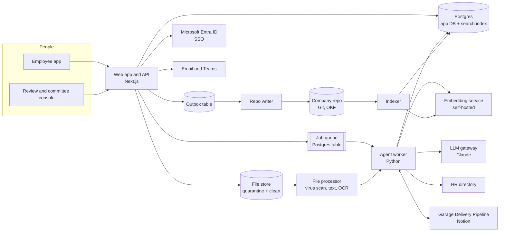
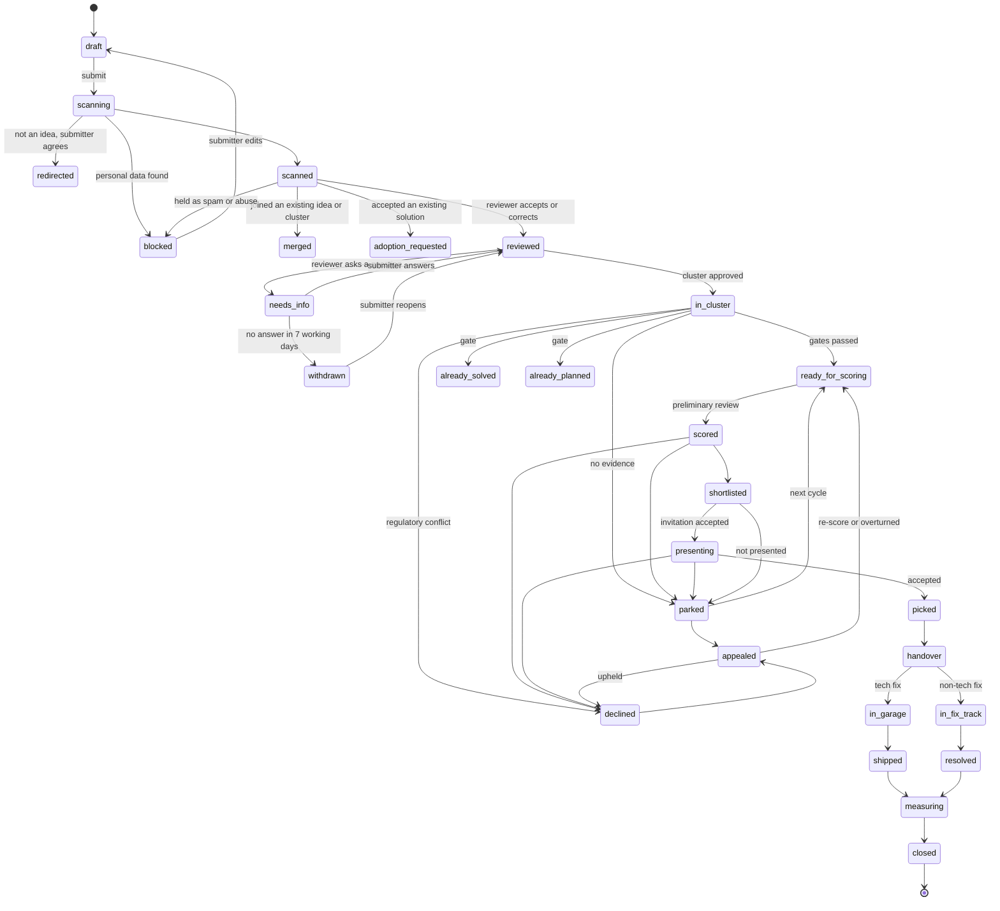
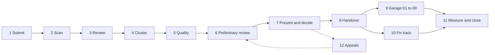
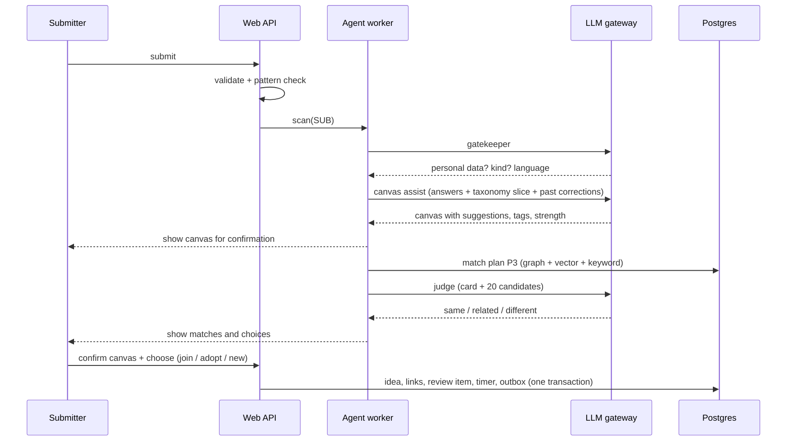
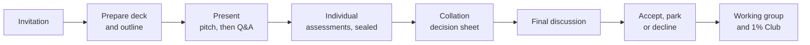
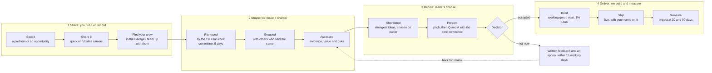
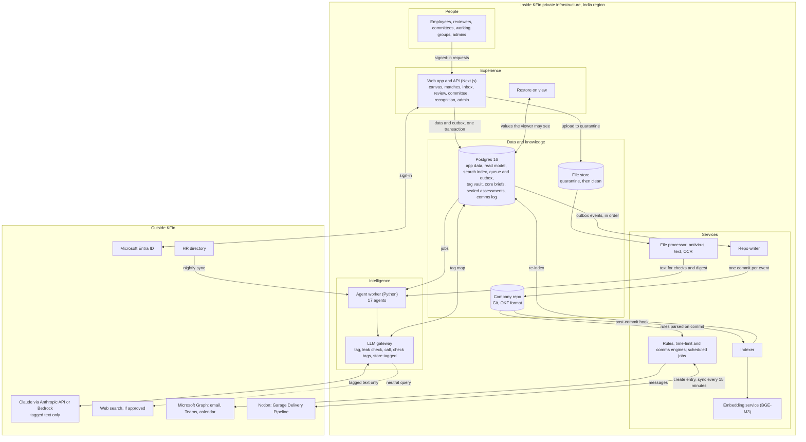
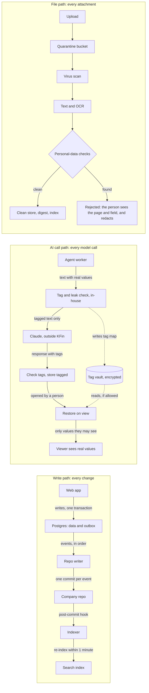

# The Garage · Ideas Platform — Technical Architecture

| | |
|---|---|
| Version | 0.3 (handoff to build) |
| Date | 8 Nov 2026 |
| Owner | Product & Strategy Lead, Domestic Business |
| Launch | New office inauguration, ~20 Nov 2026 (org-wide, day one) |
| Brand | Sub-brand under The Garage |
| Build | Claude Code, working POC, then hardened in weeks 3–8 |

## How to read this document

- Sections 1–3 describe the parts of the system and how they share data.
- Section 4 walks through every stage an idea passes through, from submission to measured impact. For each stage it lists the trigger, the steps inside, what gets written where, how failures are handled, and what is in scope for day one.
- Sections 5–10 cover learning, security, operations, the API, the build plan and cost. Section 9 has the dated plan to the 20 November launch, the go/no-go criteria, the launch modes, the launch-day runbook and the risks.
- What is out of scope, and how success is measured, sit just before Section 1.
- Anything marked **[Day 1]** must be live at launch. **[Wk 3–8]** follows after launch.

### Defaults applied (override any of these before build)

| # | Decision | Default used in this document | Confirm with |
|---|---|---|---|
| D1 | Route to Claude | Provider-neutral LLM gateway; Anthropic API or AWS Bedrock, whichever InfoSec has cleared. Before any call, personal and sensitive values are swapped for typed tags that say what the value is (for example `[[KFIN_EMPLOYEE_1]]`, `[[CLIENT_AMC_1]]`, `[[INVESTOR_NAME_1]]`). The model only ever sees tags. Outputs are stored with tags, and real values are put back only when an authorised person views the final artefact, such as the core committee's brief (§3.2) | InfoSec |
| D2 | Hosting | KFin private infrastructure, India region, containerised | IT / InfoSec |
| D3 | Day-1 attachments | Allowed: up to 5 research files per idea. On day one every file is virus-scanned; files with a text layer (PDF, Word, PowerPoint, Excel, CSV) get the pattern-based personal-data check and open to reviewers once clean. Images and scanned pages are held as "awaiting check" until OCR and the full gatekeeper check arrive in week 3. `attachment-digest` also arrives in week 3. Nobody opens a file before it is checked | Product, InfoSec |
| D4 | Default visibility | Ideas visible org-wide; submitter can mark "committee only" | Product |
| D5 | Scorecard, priority weights and 1% Club | Scorecard weights in §3.4; priority weights in §4.5; 1% Club = accepted after presenting (§4.13); perks are proposals | Core committee, HR, Finance |
| D6 | Tech stack | Next.js (TypeScript) + Postgres 16 with pgvector + Python worker | Tech (confirm if a .NET handover is planned) |
| D7 | Who hears appeals against core committee decisions | No outside seat for now. A panel of 3 rotating core committee members, with conflicted members and the brief owner excluded. An outside seat can be switched on later (`appeals.outside_seat`) | Core committee |
| D8 | Blind scoring | Yes. Committees never see names or grades while scoring | Core committee |
| D9 | People view | Admins and committees only; each person also sees their own contribution history | HR |

### Words used in this document

| Term | Meaning here |
|---|---|
| Company repo | `kfin-ideas`: a Git repository of Markdown files that holds everything the company has learned through this platform: ideas, clusters, decisions, appeals, solutions, rules. Written only by the repo writer |
| App repo | `kfin-ideas-platform`: the application code (web app, worker, agents, migrations, seed content). Built by Claude Code. Seed content is copied from here into the company repo once, at setup |
| OKF | Open Knowledge Format, Google's open specification (v0.2) for knowledge bundles: one Markdown file per concept, a YAML header block, index files per folder, and links between files |
| RAG | Retrieval-augmented generation: find relevant text first, then give it to the model. Here it means the search index built from the repo |
| Search index | Tables in Postgres holding each repo file as text, a meaning vector (embedding) and a keyword index |
| Embedding | A list of numbers that represents the meaning of a text, so similar meanings sit close together |
| Agent | A Claude call with a fixed job, fixed instructions and a fixed output format. Agents only propose; they never write to the repo |
| Core committee | The **1% Club core committee**. It owns review, shortlisting and acceptance, and runs the 1% Club. Day-to-day review is done by its review desk (see Review desk) |
| Review desk | Product team members nominated by the core committee to work the review queue and decide on its behalf. Core committee members can see every desk decision and veto it (§4.3) |
| Cluster | A group of ideas describing the same underlying problem, approved by the review desk |
| Theme | A group of related clusters |
| Coded ID | A contributor code like `CTR-7f3a91` that stands in for a person everywhere outside the app database |
| Working day (WD) | Monday to Friday excluding KFin holidays listed in `rules/calendar.md` |

### Not in scope for version 1

| Not doing | Why, and what happens instead |
|---|---|
| Native mobile app | Responsive web works on phones (O6) |
| Fetching links or browsing the web from inside the platform | Prompt-injection and data-leak risk; links are stored as given and opened by people (§6.4). `market-scan` stays off until InfoSec approves (O8) |
| Investor, customer or AMC client data in ideas | Blocked at submission (§6.3). Ideas describe problems, not records |
| Cash rewards paid automatically | Perks are proposals until HR and Finance approve (O9); the platform records them, payroll does not read from it |
| Replacing the Garage delivery pipeline | The platform hands over to the Garage and reads status back; it never writes Garage phases |
| AI making final decisions | Agents propose; the review desk and committees decide. Autonomy is earned per action type and can be switched off (§5.6, §7.6) |
| Comeback routes after a decline (demand route, sponsor route) | Dropped. Appeals are the only route; a declined idea can be resubmitted after 12 months (§4.12) |
| Public leaderboards by name without consent | Names appear only with `public_name_consent` |

### How we will know it works

| Measure | Day 30 target | Day 90 target | Source |
|---|---|---|---|
| Employees who submitted at least one idea | 10% | 20% | `ideas`, `users` |
| LOBs with at least 5 submissions | All LOBs | All LOBs | `ideas.lobs` |
| Canvas strength 3 or more at submission | 40% | 55% | `ideas.strength` |
| Review within 5 working days | 90% | 95% | `sla_timers` |
| Review desk decisions vetoed by the committee | Tracked, no target | Under 10% | `review_items.vetoed_by` |
| Desk accepts AI proposals without change | Baseline | 70% | `corrections` |
| Contributors who teamed up instead of submitting a duplicate | Baseline | 25% of matched submissions | `idea_links` |
| Clusters accepted after presenting | n/a | At least 3 | `decision_sheets` |
| Accepted clusters in the Garage or fix track within 15 working days | n/a | 100% | `garage_links`, `action_plans` |
| Leak-check hits that reached a model | 0 | 0 | `llm_calls`, gateway alerts |
| Appeals upheld | Tracked | Tracked; review if over 25% | `appeals` |

---

## 1. System overview

### 1.1 Components



| Component | Job | Talks to |
|---|---|---|
| Web app and API | All screens and REST endpoints; enforces access rules; writes app data and outbox events in one transaction | Postgres, SSO, job queue |
| Agent worker | Runs agents (scan, judge, cluster, pre-score, drafts), batch jobs and schedules | LLM gateway, embedding service, Postgres, Notion, HR directory |
| LLM gateway | One module for every model call: personal values swapped for typed tags on the way out and restored only on authorised view, model choice, prompt version, structured output, retries, cost log | Claude (via the route in D1); tag vault |
| Embedding service | Turns text into vectors. Runs inside KFin so no idea text leaves for embedding | Agent worker, indexer |
| Repo writer | The only process allowed to commit to the company repo. Reads the outbox, writes files, commits, pushes | Outbox, Git |
| Indexer | After each commit, re-reads changed files and refreshes the search index and the database read model | Git, embedding service, Postgres |
| Postgres | App database (operations), read model of the repo, search index, job queue, outbox | All services |
| File store | Research attachments: a quarantine bucket until checks pass, then a clean bucket. File contents never go into Git | Web app, file processor |
| File processor | Virus scan, text extraction, OCR, then hands the text to the agent worker for personal-data checks and a digest | File store, agent worker |
| Company repo | The permanent, versioned record of knowledge and decisions | Repo writer (write), indexer and agents (read) |

### 1.2 Technology choices

| Layer | Choice | Why |
|---|---|---|
| Web and API | Next.js 15, TypeScript, server-side rendering | One codebase for screens and API; fast to build with Claude Code |
| Auth | OpenID Connect with Microsoft Entra ID (assumed IdP; confirm with IT) | KFin runs Microsoft 365; no new passwords |
| Database | Postgres 16 with `pgvector` (HNSW index) and `pg_trgm` | One database covers records, vectors, keyword and fuzzy search, queue and outbox |
| Worker | Python 3.12, FastAPI for internal endpoints | Clustering and embedding libraries are Python-first |
| Embeddings | BGE-M3 (1,024 dimensions, multilingual, handles Hindi and Hinglish), self-hosted. Fallback: multilingual-e5-large | Keeps idea text in-house; no per-call cost |
| Clustering | scikit-learn `HDBSCAN` + `umap-learn`; agglomerative clustering for small pools | Proven for short-text topic grouping |
| Models | Fast tier: Claude Haiku 5.5 (`claude-haiku-5-5`). Reasoning tier: Claude Sonnet 5.5 (`claude-sonnet-5-5`) | Cheap, quick checks on the fast tier; matching, summaries and drafts on the reasoning tier |
| Queue | `jobs` table using `SELECT … FOR UPDATE SKIP LOCKED` | No Redis needed for this volume |
| Tagging (pseudonymisation) | Microsoft Presidio (open source, self-hosted) with KFin recognisers for Indian identifiers, the HR name list and the client list; tag vault in Postgres with column encryption | Detection stays in-house; tags are reversible only through KFin's own restore service |
| Files | S3-compatible object store on KFin infrastructure (for example MinIO); KFin's standard antivirus; `pypdf`/`pdfplumber`, `python-docx`, `python-pptx`, `openpyxl`; Tesseract OCR with English and Hindi | Keeps research files in-house; common, well-supported libraries |
| Repo hosting | KFin's internal Git server (GitLab, GitHub Enterprise or Azure DevOps — whichever is standard) | Access control and backup already exist |
| Notifications | Email via Microsoft Graph (day 1); Teams messages later | Reaches everyone without a new app |
| Deployment | Docker containers on KFin private infrastructure | Matches D2 |

---

## 2. Data architecture

Three stores, each with one clear job.

| Store | Holds | Is the truth for |
|---|---|---|
| Company repo (Git, OKF) | Ideas, clusters, themes, decisions, appeals, solutions, rules, taxonomy, learning records | Knowledge: what was said, what was decided, why |
| App database (Postgres) | Users, roles, sealed scores, +1s, timers, points, notifications, jobs, outbox, audit | Operations: who is doing what right now |
| Search index (Postgres tables built from the repo) | Text, vectors, keyword index, link graph for every repo file | Nothing. It is a copy and can be rebuilt from the repo at any time |

### 2.1 Company repo layout

```
kfin-ideas/
├── index.md                        bundle root; carries okf_version
├── log.md                          human-readable change summary (generated weekly)
├── rules/
│   ├── index.md
│   ├── scorecard.md                weights, anchors, bands, confidence multipliers
│   ├── priority.md                 priority parameters, anchors, weights, classes, override rules
│   ├── sla.md                      time limit per stage, escalation targets
│   ├── routing.md                  which committee handles which scope
│   ├── reason-codes.md             allowed outcome reasons
│   ├── thresholds.md               matching, clustering, autonomy and canvas thresholds
│   ├── points.md                   recognition points table
│   ├── compliance-tier.md          Garage standard/express rules
│   ├── redirects.md                where non-ideas go (IT helpdesk, HR portal, client service)
│   └── calendar.md                 KFin holidays for working-day maths
├── taxonomy/
│   ├── value/                      categories (cost saving, new revenue, both) and plays (process improvement, upsell, cross-sell, new product)
│   ├── areas/                      internal topic tags (process, technology, facility, people and policy, customer experience, compliance)
│   ├── lobs/                       one file per LOB
│   ├── roles/                      one file per role family
│   ├── clients/                    client organisation names and aliases, used only to tag them before model calls
│   └── glossary/                   one file per KFin system or term (NIGO, KFinKart, CAS…)
├── ideas/2026/11/IDEA-2026-000142.md
├── clusters/CL-0012.md
├── themes/TH-003.md
├── decisions/2026/DEC-2026-0031.md
├── handovers/HO-2026-0007.md
├── appeals/2026/APL-2026-0004.md
├── solutions/SOL-0004.md
├── guidance/                       committee guidance notes distilled from decisions (§5.9)
│   └── canvas/                     one anonymised example per canvas section, shown under "what good looks like"
├── comms/
│   ├── rules.md                    event → audiences, template, channels, urgency, approval
│   └── templates/                  one Markdown template per event, wording agreed with HR
├── lenses/
│   ├── lob/LOB-mf.md               generated weekly
│   └── role/ROLE-ops-executive.md  generated weekly; counts only, no names
└── learning/
    ├── corrections/2026-11.md      reviewer corrections, one table per month
    ├── cluster-runs/RUN-2026-W47.md
    └── calibration/2027-Q1.md
```

Rules for the layout:
- Every folder has an `index.md` listing its files with one line each. Only the root `index.md` carries a header block (`okf_version`), as the OKF spec requires.
- One concept per file. File names are the ID.
- The people view (§4.14) is never written to the repo. It lives only in the app database, behind access control.

### 2.2 File header schemas

OKF requires `type`. It recommends `title`, `description`, `resource` and `tags`, and v0.2 adds optional trust fields (`sources`, `generated`, `verified`, `status`, `stale_after`). Everything KFin-specific sits under one `kfin:` key so it never collides with OKF fields.

> Build note: field shapes for `generated`, `verified` and `status` follow SPEC.md v0.2 in `GoogleCloudPlatform/knowledge-catalog` (checked 8 Nov 2026, BLD-019). `verified` is omitted while a file is unverified (absence means unverified), and is a list of `{ by, at }` events once someone or something confirms it; `by` is an actor (`human:<id>`, `process:<id>` or `<tool>/<version>`); every timestamp is an ISO 8601 datetime with a UTC offset; `sources` entries are mappings with a `resource`. The validator (`python -m okf.validate`, run by `make lint`) enforces these shapes.

**Idea**
```yaml
---
type: idea
title: SIP registrations held up by manual NIGO checks
description: Ops executives re-check SIP forms by hand for missing fields, delaying registration by 1–2 days.
tags: [process, mf, sif, nigo, sip]
status: draft                      # OKF lifecycle: draft until human-reviewed
generated: { by: "canvas-assist/0.1.0", at: "2026-11-21T10:02:11+05:30" }
# verified: omitted while unverified; after review →  verified: [{ by: "human:REV-0007", at: "2026-11-24T15:40:00+05:30" }]
sources: [{ id: SUB-2026-000142, resource: "submission:SUB-2026-000142" }]
kfin:
  id: IDEA-2026-000142
  stage: in_cluster                # workflow stage, see §2.4
  kind: problem                    # problem | problem_with_solution | business_idea
  category: cost_saving            # submitter's call: cost_saving | new_revenue | both | not_sure
  play: process_improvement        # process_improvement | upsell | cross_sell | new_product | other
  basis: own_data                  # own_data | document | conversation | hunch
  strength: 4                      # canvas strength meter, 0–5
  scope: cross-lob                 # lob | cross-lob | org-wide (system tag)
  areas: [AREA-process]            # internal topic tags for search and routing
  lobs: [LOB-mf, LOB-sif]
  systems: [GL-nigo, GL-sip]
  roles_affected: [ROLE-ops-executive]
  contributor: CTR-7f3a91
  co_contributors: [CTR-1b22c0, CTR-90de41]
  cluster: CL-0012
  visibility: org                  # org | committee
  language: en
  attachments:
    - { id: ATT-2026-000311, name: nigo-rework-sample.xlsx, sha256: "9b1f…", bytes: 184220 }
  references:
    - { kind: link, player: rta, value: "https://…" }
---
## What it is
…

## Who it touches
…

## What it's worth to KFintech (submitter's estimate and basis)
…

## Solved elsewhere, and why KFintech
…

## Proposed solution, needs and risks
…

## Research
Digest of each clean attachment, with page references.

## Answers suggested by the assistant
Which canvas fields were suggested, and whether the submitter accepted or edited them.

## Original text
> (exact text as submitted, after personal-data check)

## History
| When | Event | By | Note |
|---|---|---|---|
| 2026-11-21 10:02 | submitted | CTR-7f3a91 | |
| 2026-11-21 10:02 | scanned | agent:scan@1.3 | proposed CL-0012 (high) |
| 2026-11-24 15:40 | reviewed | REV-0007 | area tags confirmed; attached to CL-0012 |
```

**Cluster**
```yaml
---
type: cluster
title: Manual NIGO checks on SIP and lumpsum forms
description: Same problem raised by 4 people across MF and SIF operations.
tags: [process, nigo, sip]
status: stable
verified: [{ by: "human:REV-0007", at: "…" }]
generated: { by: "cluster-summary/1.1.0", at: "…" }
kfin:
  id: CL-0012
  stage: ready_for_scoring
  theme: TH-003
  members: [IDEA-2026-000142, IDEA-2026-000155, IDEA-2026-000171, IDEA-2026-000190]
  distinct_contributors: 4
  lobs: [LOB-mf, LOB-sif]
  scope: cross-lob
  route_to: core
  related_solutions: [SOL-0004]
  working_group: WG-0005
---
## Combined problem statement
## Variations raised
## Combined solution draft (with credit)
## Evidence
## Impact estimate
## Open questions
## History
```

**Decision** (`type: decision`): `kfin.id`, `cluster`, `body` (lob or core committee), `outcome` (picked | parked | declined | redirected | already-solved | already-planned | overturned), `route` (reuse | build | buy | partner; picks only, no vendor names or prices), `reason_code`, `scorecard_version`, `final_score`, `dimension_medians`, `members_present`, `recused`, `override` (true/false and written reason), `appeal_window_closes`. Body: plain-language reason, what would change the decision, link to scores. `stale_after` is 12 months for declines.

**Solution** (`type: solution`): what was built or fixed, where (LOB, system), owner, `source_cluster`, `garage_feature_slug`, baseline and actual metric at 30 and 90 days, actual capex and opex, lessons, how other LOBs can adopt it. `stale_after` is 6 months, so the owner re-confirms it is still in use.

**Appeal** (`type: appeal`): `appellant`, `decision`, `grounds`, `panel`, `hearing`, `outcome` (upheld | re-score | overturned), `reasons`.

**Glossary term** (`type: glossary-term`): term, aliases (for keyword and fuzzy match), definition, owning team, links to related clusters and solutions.

**Rule files** (`type: rule`): a human-readable explanation plus one fenced `yaml` block the rules engine parses (§3.4). Each rule file carries `kfin.version`, and every decision records the versions it used.

### 2.3 IDs

| Object | Pattern | Example |
|---|---|---|
| Submission | `SUB-YYYY-NNNNNN` | SUB-2026-000142 |
| Idea | `IDEA-YYYY-NNNNNN` (same number as the submission) | IDEA-2026-000142 |
| Cluster | `CL-NNNN` | CL-0012 |
| Theme | `TH-NNN` | TH-003 |
| Decision | `DEC-YYYY-NNNN` | DEC-2026-0031 |
| Handover | `HO-YYYY-NNNN` | HO-2026-0007 |
| Appeal | `APL-YYYY-NNNN` | APL-2026-0004 |
| Solution | `SOL-NNNN` | SOL-0004 |
| Working group | `WG-NNNN` | WG-0005 |
| Contributor | `CTR-` + first 6 hex characters of HMAC-SHA256(employee ID, secret) | CTR-7f3a91 |
| Reviewer / member | `REV-NNNN` (staff code for role holders; names shown only inside the app) | REV-0007 |
| Attachment | `ATT-YYYY-NNNNNN` | ATT-2026-000311 |
| Area tag, LOB, role, glossary | `AREA-`, `LOB-`, `ROLE-`, `GL-` + slug | GL-nigo |

On a code collision, extend the contributor code to 8 characters. The secret sits in the vault, never in the repo.

### 2.4 Workflow stages

`kfin.stage` drives the workflow. OKF `status` is kept for lifecycle only (draft, stable, deprecated).



Ideas and clusters both carry a stage. Up to `in_cluster`, the stage belongs to the idea. From `ready_for_scoring` onwards, the cluster carries it and every member idea mirrors it.

### 2.5 App database (main tables)

| Table | Key columns | Notes |
|---|---|---|
| `users` | id, emp_id_hash, name, email, lob_id, role_title, location, active | Refreshed nightly from the HR directory |
| `contributor_map` | contributor_code, user_id | Restricted role. Deleting a row anonymises that person everywhere |
| `role_grants` | user_id, role, scope_id, granted_by, from, to | Committee seats, reviewer, admin, panel, sponsor |
| `ideas` | idea_id, stage, kind, category, play, basis, strength, scope, area_ids[], lobs[], systems[], cluster_id, visibility, contributor_code, canvas jsonb (with provenance), repo_path, repo_commit, created_at, updated_at | Read model of the repo plus live stage |
| `attachments` | id, idea_id, uploaded_by_code, name, mime, bytes, sha256, store_key, state (quarantine, awaiting_check, clean, rejected), rejection (type, location), digest, created_at | File contents stay in the file store |
| `core_briefs` | cluster_id, version, priority_ratings jsonb, priority_score, priority_class, rules_version, build_buy_options jsonb, recommended_route, confidence, market_refs jsonb, case_for, case_against, questions jsonb, owner_id, validated_at | Core committee only (row-level security); every view logged; never written to the repo |
| `presentations` | id, cluster_id, presenters[], slot_at, deck_attachment_id, state (invited, accepted, scheduled, held, no_show, withdrawn), notes | |
| `assessments` | id, cluster_id, member_id, stage (preliminary, post_presentation), dimension_scores jsonb, vote (accept, accept_with_conditions, park, decline), route_pref, strengths[], concerns[], conditions[], open_questions[], will_sponsor, submitted_at | Sealed until collation; never written to the repo |
| `decision_sheets` | cluster_id, cycle_id, tallies jsonb, themes jsonb, divergence_flags[], precedent_refs[], capacity_fit, generated_at | Collated view for the final discussion |
| `comms_log` | id, event, template_version, recipients[], channel, signer_id, approved_at, sent_at, state, read_at (in-app only) | Email opens are not tracked |
| `comms_prefs` | user_id, routine (immediate, digest), manager_notes (on, off), public_name_consent | |
| `idea_links` | idea_id or cluster_id, contributor_code, link_type (originator, joiner, plus_one, adoption), context_text, created_at | +1s, joins and adoption requests |
| `clusters`, `themes` | id, stage, scope, route_to, lobs[], member_count, distinct_contributors, centroid vector(1024) | Read model plus centroid for matching |
| `review_items` | id, item_type (idea, cluster_proposal, taxonomy_proposal, glossary_proposal, working_group_trigger, disagreement), ref_id, proposal jsonb, confidence jsonb, reasons jsonb, state, assigned_to, due_at, decided_by, decided_at, final jsonb, vetoed_by, veto_reason, vetoed_at | The review console queue, with desk decisions and committee vetoes |
| `corrections` | review_item_id, field, proposed, final, reviewer_id, note, created_at | Mirrored monthly to `learning/corrections/` |
| `scoring_rounds` | id, cluster_id, body, scorecard_version, opens_at, closes_at, state | |
| `sealed_scores` | round_id, member_id, dimension, value, comment, submitted_at, revised_value, revised_at | Not readable by anyone until reveal |
| `ai_prescores` | round_id, dimension, value, rationale, evidence_refs | Hidden until the member has submitted |
| `coi_flags` | round_id, member_id, reason, status (declared, recused, cleared) | |
| `cycles` | id, name, opens_at, shortlist_by, presentations_from, presentations_to, decisions_by, state (open, shortlisting, presenting, deciding, closed) | One core committee decision cycle; usually monthly |
| `capacity` | cycle_id, garage_slots, wg_hours, capex_budget_inr | Declared by the core committee each cycle |
| `working_groups` | id (`WG-`), cluster_id, sponsor_id, product_owner_id, members jsonb (contributor_code, role, protected_hours, manager_ack_at), charter_path, state (forming, active, showcasing, closed), formed_at, closed_at | Created on acceptance (§4.7); members also get `role_grants` scoped to the group |
| `handover_packs` | id, cluster_id, fields jsonb, completeness, sponsor_id, sponsor_approved_at | |
| `garage_links` | cluster_id, notion_page_id, feature_slug, last_phase, gate_status, synced_at | |
| `action_plans`, `milestones`, `evidence` | | Non-tech fix track |
| `appeals` | id, decision_id, appellant_code, grounds[], state, panel[], due_at, outcome | |
| `sla_timers` | entity_type, entity_id, stage, started_at, due_at, paused_total, state, escalated_at | |
| `points_ledger` | id, contributor_code, event, points, ref_id, created_at | Append-only |
| `recognition_events` | id, contributor_code, milestone (contributor … recognised annually), perk, granted_by, approved_by_hr, starts_at, ends_at | 1% Club membership and perks live here |
| `notifications` | id, user_id, channel, template, payload, sent_at, state | |
| `outbox` | id, event_type, aggregate_id, payload jsonb, created_at, committed_at, commit_sha, attempts | Feeds the repo writer |
| `jobs` | id, type, payload, run_at, state, attempts, locked_by, last_error | |
| `llm_calls` | id, agent, prompt_version, model, input_tokens, output_tokens, latency_ms, cost_inr, tags_by_type jsonb, outcome, ref_id | No prompt text stored |
| `pseudonym_vault` | scope_id (idea or cluster), tag, type, value_encrypted, created_at, expires_at | Readable only by the gateway's restore service; retention follows the idea; deleted with the idea or on anonymisation |
| `autonomy` | action_type, mode (gated, auto), window_accept_rate, window_size, changed_by, changed_at | §5.6 |
| `learning_proposals` | id, kind (weight, threshold, guidance, prompt_example, taxonomy, glossary), target_path, proposal jsonb, evidence_refs[], state (proposed, accepted, rejected, applied), decided_by, decided_at, applied_commit | Everything the learning loop wants to change (§5); nothing changes until a named person accepts it |
| `kill_switches` | name, state (on, off), reason, changed_by, changed_at | §7.6; read on every request, cached for 10 seconds |
| `audit_log` | id, actor, action, entity, before, after, at, ip | Every admin action and every identity reveal |

### 2.6 Search index (built from the repo)

| Table | Columns |
|---|---|
| `chunks` | id, repo_path (or attachment ID), file_type (idea, cluster, decision, solution, attachment, garage_feature…), section, text, embedding vector(1024), tsv tsvector, trust (unverified, machine, human), stage, lobs[], category, area_ids[], visibility, updated_at, commit_sha |
| `links` | from_path, to_path, link_type (markdown link, frontmatter reference) |
| `terms` | glossary_id, term, alias, trigram index |

- Ideas are short, so each idea is one chunk built from title, problem, who is affected, where and workaround. Clusters, decisions and solutions are split by `##` section.
- Indexes: HNSW on `embedding` (cosine), GIN on `tsv` with the `simple` text-search config (keeps acronyms and Hinglish words intact), and `pg_trgm` on `terms` for near-miss spellings.
- `links` is built from Markdown links and header references. It turns the repo into a navigable graph for exact lookups (§3.3).
- A full rebuild (`indexer --rebuild`) must finish in under 30 minutes for 50,000 files. Run it after any embedding-model change.

### 2.7 Who owns the truth, and how writes stay consistent

Every write follows the same path:

1. The API writes app data **and** an `outbox` row in one database transaction.
2. The repo writer picks up outbox rows in order, writes or updates the file, commits with a structured message, and pushes. It records `commit_sha` on the outbox row.
3. The indexer receives a post-commit hook (or polls every 10 seconds), re-indexes changed files and updates the read model.

Commit message format:
```
[IDEA-2026-000142] reviewed — area tags confirmed, attached to CL-0012
actor: REV-0007
event: idea.reviewed
outbox: 88213
```

| If… | Then… |
|---|---|
| The repo writer is down | Outbox rows queue up; the app keeps working. Writer catches up in order on restart |
| A push fails (remote unreachable) | Retry with backoff; alert after 15 minutes; commits stay local until push succeeds |
| The read model and repo disagree | Nightly `reconcile` job re-reads the repo and fixes the read model; mismatches are logged |
| The database is lost | Restore from backup; replay the repo into the read model; operational data (sealed scores, timers) comes from the database backup |

The repo writer is a single process. That avoids merge conflicts, and the volume (a few thousand commits a month) needs no more.

---

## 3. Shared services

### 3.1 Identity and access

**Sign-in**
1. OpenID Connect authorisation-code flow with PKCE against Microsoft Entra ID. Claims used: `oid`, `email`, `name`, `employeeId` (if released by IT).
2. On first sign-in the user is matched to the HR directory record by employee ID (or email as fallback), and the privacy notice is shown. Acceptance is stored with the notice version.
3. Session: HTTP-only secure cookie, 8-hour lifetime, refreshed on activity.

**HR directory sync** (nightly, 01:00)
- Source: Microsoft Graph user attributes (`department`, `jobTitle`, `officeLocation`, `employeeId`) or the HRMS export, whichever IT provides.
- `department` maps to an LOB using the department list inside each `taxonomy/lobs/*.md` file. `jobTitle` maps to a role family using patterns in `taxonomy/roles/*.md`.
- Unmapped departments or titles go to the review console as a `taxonomy_proposal`. Leavers are marked inactive. Their ideas stay, under their coded ID.

**Roles and permissions**

| Action | Contributor | Reviewer (core committee's review desk) | LOB committee | Core committee | Appeal panel | Working group | Sponsor | Admin |
|---|---|---|---|---|---|---|---|---|
| Submit, join, +1, appeal own outcomes | ✓ | ✓ | ✓ | ✓ | ✓ | ✓ | ✓ | ✓ |
| See org-visible ideas and clusters | ✓ | ✓ | ✓ | ✓ | ✓ | ✓ | ✓ | ✓ |
| See committee-only ideas | own only | ✓ | own LOB | ✓ | case only | own cluster | own cluster | ✓ |
| Work the review queue | | ✓ | | | | | | ✓ |
| View the queue and desk decisions | | ✓ | | ✓ | | | | ✓ |
| Veto a desk decision (within 5 working days, with reason) | | | | ✓ | | | | |
| Approve cluster proposals | | ✓ | | | | | | ✓ |
| Propose rule and taxonomy changes | | ✓ | | | | | | ✓ |
| Approve scorecard changes | | | | ✓ | | | | |
| See core briefs (priority classification, build-vs-buy) | | | | ✓ | | | | |
| Present to the core committee | when invited | | | | | | | |
| Open research attachments (after checks pass) | as idea | as idea | as idea | as idea | as idea | as idea | as idea | as idea |
| See real values behind tags in AI-produced text | own idea | items they handle | own LOB items | ✓ | case only | own cluster | own cluster | ✓ with reason, logged |
| Score | | | own LOB | ✓ | | | | |
| Decide (pick, park, decline) | | | park or decline own-LOB scope; nominate the rest | ✓ | | | | |
| Hear appeals | | | | LOB appeals | ✓ | | | |
| Run action plans, update milestones | | | | | | ✓ | ✓ | ✓ |
| Approve handover pack, confirm results | | | | | | | ✓ | |
| See the people view | own history | ✓ | own LOB | ✓ | | | | ✓ |
| Reveal a contributor's identity | | | | | | | | ✓ with reason, logged |
| Grant roles | | | | | | | | ✓ |

**Blind mode**
- Every endpoint used for review of scoring content (`/committee/*`, `/appeals/*` for panel members) serialises contributors as `Contributor 1…n`, consistent within one cluster.
- These endpoints never return name, grade, role title or the contributor's own LOB. The idea's LOB tags (where the problem sits) remain, because scope needs them.
- Identity reveal is admin-only, needs a written reason, writes to `audit_log`, and is counted in the quarterly fairness report.

**Conflict-of-interest detection** (runs when a scoring round or appeal panel is created)
- Flag a member if they are a contributor or co-contributor in the cluster.
- Flag a member if they manage the team named in the cluster's "who is affected" section (match on `users.lob_id` and HR manager chain).
- For appeals: flag a member if they sit on the LOB committee whose decision is under appeal. For appeals against core committee decisions, the brief owner is always excluded. The panel must include at least one member who didn't vote for the original outcome (§4.12).
- A flagged member must either declare and recuse, or have an admin clear the flag with a reason. The outcome is stored in `coi_flags` and written to the decision file.

### 3.2 LLM gateway and agents

All model calls go through one interface:

```
run_agent(name: str, inputs: dict, ref_id: str) -> ValidatedOutput
```

Each agent lives in the app code repo under `agents/<name>/`:

| File | Content |
|---|---|
| `prompt.md` | System instructions |
| `schema.json` | JSON Schema for the output; enforced with structured output / tool use |
| `config.yaml` | Model tier, temperature, max tokens, timeout, retries, cache TTL |
| `examples/` | Fixed examples included in every call |
| `CHANGELOG.md` | Version history. Any change bumps the version and must pass the golden-set check (§5.5) before deploy |

**What the gateway does on every call**
1. **Tag on the way out (pseudonymise).** Detection runs inside KFin; no text leaves for detection. It uses:
   - the §4.2 step 2 patterns;
   - names, emails and employee IDs from `users`, plus contributor and reviewer codes;
   - KFin client organisation names from `taxonomy/`;
   - a self-hosted named-entity detector for any other person names (for example Microsoft Presidio, with KFin-specific recognisers).

   Each value found is replaced with a typed tag that says what the value is, so the model can still reason about it:

   | Value | Tag |
   |---|---|
   | KFin employee named in text | `[[KFIN_EMPLOYEE_1]]` |
   | Contributor, reviewer, committee member | `[[CONTRIBUTOR_2]]`, `[[REVIEWER_1]]`, `[[MEMBER_3]]` |
   | Other person, role unknown | `[[PERSON_1]]` |
   | Investor or customer name (role read from context) | `[[INVESTOR_NAME_1]]` |
   | KFin client organisation | `[[CLIENT_AMC_1]]`, `[[CLIENT_ISSUER_1]]` |
   | Identifiers and contact details | `[[PAN_1]]`, `[[FOLIO_NUMBER_1]]`, `[[ACCOUNT_NUMBER_1]]`, `[[EMAIL_1]]`, `[[PHONE_1]]` |

   - **Consistent tags.** The same value always gets the same tag within one idea or cluster, across every call, so multi-step work stays coherent: canvas assist, judge, brief and collation all mean the same `[[CLIENT_AMC_1]]`.
   - **The tag map** (tag → real value) is kept encrypted in `pseudonym_vault`, scoped to the idea or cluster. Only the gateway's restore service can read it.
   - **Not tagged:** public competitor and vendor names (needed for market analysis), KFin product and system names, amounts and dates.
   - **Instruction to the model:** tags stand for real values it will never see. Copy a tag exactly when it needs to refer to it; never guess a real value; never invent a new tag.
2. **Leak check.** The patterns run again on the tagged payload. Any remaining match aborts the call and raises an alert, because it means detection missed something.
3. **Untrusted input wrapping.** Puts all user text inside `<idea_text>…</idea_text>` style tags. The system prompt states that content inside these tags is data to analyse, never instructions. Agents get no tools other than the output schema, and never fetch URLs.
   - The single exception is `market-scan` (if InfoSec approves): it gets web search only, and only after it has rewritten the problem as a neutral statement.
   - A search query containing any tag or personal-data pattern is blocked, so neither tags nor real values ever reach a search engine.
4. **Cache lookup.** Key is the hash of agent name, version and the *tagged* inputs, so the cache never holds real values. TTL is 30 days.
5. **Rate control.** A token bucket per model tier and a concurrency cap (default 20 reasoning calls in flight). Overflow goes to the job queue.
6. **Call and validate.** Temperature 0 for classification and judging, 0.3 for drafting. If the output fails schema validation, retry once with the validation error. A second failure returns `AgentFailed` and the caller takes its fallback path.
7. **Check the tags that come back.** Only tags that were sent are allowed in the response. An unknown or altered tag is flagged and left unrestored.
8. **Store tagged; restore on view.** Outputs are stored with tags intact in the database, the repo and the search index. Real values are swapped back only when a person views or exports the artefact, and only for values that person may see under §3.1:
   - Core committee members see real values in core briefs, decision sheets and pre-reads.
   - Reviewers see real values in canvases and proposals they handle.
   - Contributors see real values from their own idea.
   - Anyone else sees a neutral label, such as "a colleague" or "an AMC client".

   PDF exports (for example presentation pre-reads) are restored at export time, watermarked with the viewer's name, and logged.
9. **Log.** One `llm_calls` row: agent, version, model, tokens, latency, cost in rupees, number of tags by type, outcome. Prompt and response text are not logged.

Investor and customer identifiers are still blocked at submission (§4.2). Tagging protects everything that is legitimately allowed, such as colleague names, KFin emails and client names, and anything that slips past the entry checks.

Provider settings: zero data retention where the route offers it, and the region agreed with InfoSec (D1).

**Agent registry**

| Agent | Tier | Used in | Input | Output | Latency budget |
|---|---|---|---|---|---|
| `gatekeeper` | Fast | Scan step 3; attachment checks | Raw text | Personal-data spans, kind (idea_problem, idea_solution, business_idea, it_ticket, hr_grievance, complaint, question, spam), language, confidence | 2 s |
| `canvas-assist` | Reasoning | Scan step 4 | The person's answers + taxonomy slice + attachment digests | Full canvas with suggestions, internal tags, flags, strength and next-best additions | 5 s |
| `attachment-digest` | Reasoning | Attachments | Extracted text of one clean file | Summary (≤ 150 words), key claims and figures with page references | Async, ≤ 60 s |
| `judge` | Reasoning | Scan step 6; consistency checks | Card + up to 20 candidates + up to 5 past corrections | Label (same, related, different) + reason + confidence per candidate | 5 s |
| `cluster-summary` | Reasoning | Weekly clustering | Member cards | Name, combined problem, variations, combined solution with credit, open questions | Batch |
| `gate-check` | Fast | Qualify | Cluster + roadmap and solution hits | Suggested result for each gate, with evidence | Batch |
| `impact-draft` | Reasoning | Qualify | Cluster + evidence | Draft capex, opex, one-time and recurring revenue or saving, with assumptions listed | Batch |
| `market-scan` | Reasoning + web search | Qualify, core route only; needs InfoSec approval (O8) | A neutral problem statement the agent writes first, with no idea text, internal names or client names | Players and products that address it, with source links | Batch |
| `build-vs-buy` | Reasoning | Qualify, core route only | Cluster + reuse hits + submitter references + attachment digests + market scan | Reuse, build, buy and partner options with costs, time, control, regulatory points, risks; recommended route and confidence | Batch |
| `priority-brief` | Reasoning | Qualify, core route only | Cluster + impact estimate + market picture + build-vs-buy + `rules/priority.md` anchors + approved committee guidance + nearest decided precedents | Eight parameter ratings with evidence and rationale; case for, case against, three questions for presenters. The class itself is computed by the rules engine | Batch |
| `pitch-prep` | Reasoning | Present | Canvas + cluster file | Editable outline for the 8-slide deck | Batch |
| `collation` | Reasoning | Decide | Sealed individual assessments for one cluster + core brief + precedents | Themes in strengths and concerns with counts, merged conditions, divergence notes. Tallies and medians come from the rules engine | Batch |
| `guidance-distiller` | Reasoning | After each decision cycle | The cycle's decisions, reasons and collated themes + existing guidance | Proposed new or revised committee guidance notes, with the decisions that support each (§5.9) | Batch |
| `prescore` | Reasoning | Score | Cluster + scorecard anchors | Score per dimension + rationale + evidence references | Batch |
| `reason-writer` | Reasoning | Shortlist, decide, appeals, communication | Committee comments or collated themes + reason code | Plain-language reason, feedback summary, invitation note, "what would change this decision" | Batch |
| `brief-writer` | Reasoning | Handover | Cluster + handover pack | Garage feature brief (problem, user, opportunity, constraints) | Batch |
| `taxonomy-proposer` | Reasoning | Monthly learning | Poorly fitting ideas | Proposed new or split area tags with definitions and examples | Batch |
| `glossary-miner` | Fast | Weekly learning | New terms with sample sentences | Proposed glossary entries | Batch |
| `role-themes` | Reasoning | Weekly lenses | Ideas from one role family | Recurring friction themes for that role | Batch |

### 3.3 Router: retrieval plans

The router is ordinary code. Each question the system asks has one fixed retrieval plan. The model is used only after retrieval, to judge what was found.

| Plan | Question | Steps |
|---|---|---|
| P1 `rules` | Which committee, scorecard, time limit or reason codes apply? | Read the parsed YAML from `rules/*.md` (held in memory, refreshed on commit). No search. If a rule is missing, raise a configuration error; never guess |
| P2 `taxonomy_slice` | Which known terms, systems, LOBs and area tags does this text mention? | Exact and fuzzy (`pg_trgm`, similarity ≥ 0.4) match of glossary terms and aliases against the text. Return matched `GL-` IDs plus the full lists of area tags, LOBs, categories and plays (they are small) |
| P3 `match` | Has this problem been raised, solved or declined before? | See below |
| P4 `similar_decisions` | Have similar clusters been decided differently? | Vector search over decided clusters and decisions; keep top 5 with cosine ≥ 0.80 |
| P5 `roadmap_check` | Is this already planned? | Vector and keyword search over Garage features (mirrored from Notion into `chunks` with `file_type = garage_feature`) and solutions; top 10 to `gate-check` |
| P6 `corrections_for` | What did reviewers correct in similar cases? | Vector search over the original cards of past corrections, filtered by field; top 5 become examples for `canvas-assist` or `judge` |
| P7 `status` | Where is this now, and who has it? | Read model in Postgres, plus `garage_links` for Garage items |
| P8 `precedents` | How did the core committee decide similar clusters? | Vector search over decision chunks with outcome `picked`, `parked` or `declined`; top 5 with their ratings, route and reasons. Core committee views only |

**Plan P3 `match`, step by step**
1. **Graph lookup (OKF).** Take the `GL-` IDs from P2. Follow `links` up to two hops to clusters, solutions and decisions that mention those terms. Every result is tagged `via: graph`.
2. **Meaning search (RAG).** Embed the card text. Run an HNSW cosine search over `chunks` where `file_type ∈ {idea, cluster, solution, decision}`. Take the top 50 above cosine 0.45.
3. **Keyword search (RAG).** Run `websearch_to_tsquery('simple', …)` against `tsv`. Take the top 50.
4. **Fuse.** Reciprocal rank fusion: `score = Σ 1 / (60 + rank)` across the three lists (graph results get rank 1 in their own list).
5. **Weigh trust.** Multiply by 1.15 for human-reviewed files, 1.0 for machine-confirmed, 0.9 for unverified.
6. **Keep "solved" and "declined" visible.** Reserve at least 3 slots each for solutions and decisions when any exist above the cosine floor, so a crowd of open ideas cannot push them out.
7. **Cut to 20.** Apply visibility: committee-only items are kept for the reviewer's view but removed from what the submitter sees.
8. **Judge.** Send the card and the 20 candidates (each trimmed to about 120 tokens), plus 5 examples from P6, to `judge`.

All numbers above live in `rules/thresholds.md` and can be tuned without code.

### 3.4 Rules engine

Each rule file has a short explanation followed by one `yaml` block. The engine parses that block on every commit to `rules/`, validates it against a schema in the app code, and keeps every version so past decisions can be replayed.

Example from `rules/scorecard.md`:
```yaml
version: 1.0
scale: [1, 5]
dimensions:
  financial_value:   { weight: 30, measure: annual_net_benefit_band }
  customer_experience: { weight: 20 }
  risk_compliance:   { weight: 15 }
  reach:             { weight: 15 }
  time_to_value:     { weight: 10 }
  effort:            { weight: 10 }
financial_bands_inr_per_year:   # annual net benefit = recurring benefit − opex − capex/5
  1: [null, 500000]
  2: [500000, 2500000]
  3: [2500000, 10000000]
  4: [10000000, 50000000]
  5: [50000000, null]
confidence_multiplier: { data_backed: 1.0, estimate: 0.8, anecdote: 0.5 }
divergence_flag_points: 2
```

Example from `rules/thresholds.md`:
```yaml
gatekeeper: { personal_data_block: 0.5, redirect_suggest: 0.8, spam_hold: 0.9 }
match:   { cosine_floor: 0.45, top_k_each: 50, final_k: 20, rrf_k: 60, reserve_solved: 3, reserve_declined: 3, rerun_if_edit_share: 0.20 }
trust_boost: { human: 1.15, machine: 1.0, unverified: 0.9 }
cluster: { min_cluster_size: 3, min_samples: 2, small_pool_cutoff: 200, small_pool_distance: 0.25,
           pair_cosine: 0.85, grow_overlap: 0.5, new_max_centroid: 0.80, merge_centroid: 0.90,
           split_between: 0.75, theme_distance: 0.35 }
working_group_trigger: { min_contributors: 3, min_lobs: 2 }
autonomy: { promote_at: 0.95, demote_below: 0.90, window: 200, spot_check_rate: 0.05 }
consistency: { similarity: 0.80, score_gap: 20 }
```

Changes to `rules/` go through a pull request. Admins approve; scorecard changes also need core committee approval, recorded in the PR.

### 3.5 Scheduled jobs

| Job | When | What it does |
|---|---|---|
| `index.file` | After every commit | Re-index changed files; update read model |
| `scan.async` | When a scan fails twice or passes 20 s | Retry the scan at 1, 5, 15 and 60 minutes, then hand to the review desk as "scan failed" (§4.2) |
| `attachment.process` | On upload | Virus scan, text extraction, personal-data check; OCR and digest from week 3 (§4.2) |
| `hr.sync` | Daily 01:00 | Refresh users, LOBs and roles from the HR directory |
| `reconcile` | Daily 02:00 | Compare repo with read model; fix and log drift |
| `autonomy.evaluate` | Daily 07:00 | Recompute acceptance rates; promote or demote action types (§5.6) |
| `sla.tick` | Every 15 min | Reminders, breaches, escalations (§3.6) |
| `garage.sync` | Every 15 min | Pull phase changes from the Garage Delivery Pipeline (§4.9) |
| `glossary.mine` | Weekly, Sunday 20:00 | Propose new glossary terms (§5.3) |
| `cluster.batch` | Weekly, Sunday 22:00 | Clustering run; proposals to review console (§4.4) |
| `lenses.build` | Weekly, Monday 05:00 | LOB, role and people views (§4.14) |
| `digest.weekly` | Friday 16:00 | Summary emails to contributors, committees and sponsors |
| `log.generate` | Friday 18:00 | Write the weekly summary into root `log.md` |
| `theme.batch` | Monthly, first Sunday | Group clusters into themes |
| `taxonomy.propose` | Monthly, first Monday | Propose new or split area tags (§5.2) |
| `canvas.nudge` | Daily 10:00 | Reminder 2 and 7 days after a quick capture while strength is below 3; never more than two |
| `stale.review` | Monthly | Files past `stale_after` go to their owners for re-confirmation |
| `points.leaderboard` | Daily 03:00 | Refresh leaderboard view |
| `club.renewals` | Monthly | 1% Club memberships due to lapse; renewal by another acceptance, delivery or mentoring |
| `decision.learn` | After each core committee decision cycle | Precedents, revealed priorities, guidance proposals, fairness checks (§5.9) |
| `pulse.compose` | Last working day of the month | Draft the Garage Pulse for the product lead's approval |
| `golden.eval` | On every agent deploy, and weekly | Run the golden sets; block deploy on regression (§5.5) |

### 3.6 Time limits (SLA engine)

`rules/sla.md`:
```yaml
review:          { limit_wd: 5,  remind_at: [0.5, 0.8], escalate_to: core_chair }
veto_window:     { limit_wd: 5 }                                   # after a desk decision
needs_info:      { limit_wd: 7,  on_breach: withdraw_with_reopen }
cluster_proposal: { limit_wd: 5, escalate_to: core_chair }
qualify:         { limit_wd: 10, escalate_to: core_chair }
scoring_round:   { limit_wd: 10, escalate_to: core_chair }
invitation_reply:      { limit_wd: 3,  on_breach: remind_then_next_session }
deck_upload:           { due_wd_before_session: 2, on_breach: move_to_next_session }
individual_assessment: { limit_wd: 2,  escalate_to: core_chair }   # after the session
final_decision:        { limit_wd: 10, escalate_to: core_chair }   # from presentation to decision
outcome_message:       { limit_wd: 2,  escalate_to: core_chair }   # from decision to message sent
handover:        { limit_wd: 5,  escalate_to: sponsor }
appeal_window:   { limit_wd: 15 }
appeal_decision: { limit_wd: 15, escalate_to: core_chair }
measure_30:      { limit_days: 30 }
measure_90:      { limit_days: 90 }
```

How it works:
- A timer starts when an entity enters a stage and stops when it leaves. `needs_info` pauses the review timer.
- Working days are counted in IST using `rules/calendar.md`.
- Reminders go to the current owner at 50% and 80% of the limit.
- On breach, the timer turns `breached`, the escalation target is notified, and a line is added to the idea's history.
- Breaches show on the dashboard with their age, and give the contributor grounds to appeal (§4.12).
- If a submitter doesn't answer a `needs_info` question within 7 working days, the idea is marked withdrawn. The submitter can reopen it at any time.

### 3.7 Communication module

How people hear about what is happening matters as much as the decisions themselves. If submitters hear nothing, they stop submitting.

**Principles**
1. **Nobody waits in silence.** Every stage change on someone's idea produces a message saying what happened, why, what happens next, and by when.
2. **Key moments come from a person.** Invitations to present, acceptances, declines and appeal outcomes are signed by the committee chair, or by the sponsor for working-group starts. The system drafts and sends them only after that person approves.
3. **Specific, not generic.** Messages quote the idea's one-line, name the cluster, and carry the committee's actual feedback.
4. **Celebrate in public, explain in private.** Acceptances and shipped results are announced to the organisation, with the person's consent. Parks and declines go only to the contributors.
5. **Respect attention.** Quiet hours, digests for low-urgency updates, and a cap on how often anyone is emailed.

**Channels**

| Channel | Used for | Notes |
|---|---|---|
| In-app inbox | Everything | The permanent record; every message lands here, even if also emailed |
| Email (Microsoft Graph, "The Garage" service mailbox) | Decisions, invitations, questions, reminders, digests | Replies go into the in-app thread, never to an unread mailbox |
| Teams message | Time-critical items: presentation reminders, pending approvals, breaches | From week 3 |
| Calendar invite | Presentation slots, appeal hearings, working-group kick-off | Sent from the chair's or product lead's calendar through Microsoft Graph |
| Manager note | Shortlisted, accepted, shipped | On by default; the employee can switch it off |
| Public wall and the monthly "Garage Pulse" | Organisation-wide news: picks, 1% Club inductees, shipped results, numbers | Wall is live from day 1; Pulse from month 1 |
| Town hall and leadership packs | Quarterly recognition and results | Content pack generated for the CEO's office |

**Who hears what, at every step**

| Step | Who hears | What the message says | Channel | Signed by | When |
|---|---|---|---|---|---|
| Submitted | Submitter | Received; idea ID and one-line; review within 5 working days; two tips to strengthen the canvas | In-app, email | The Garage team | Immediately |
| Quick capture not enriched | Submitter | Two most useful things to add | In-app, email | The Garage team | Days 2 and 7, only while strength is below 3 |
| Someone joins your idea | Existing contributors | "N more colleagues raised the same thing"; names if the idea is org-visible | In-app; weekly digest | System | On join |
| Adoption requested | Solution owner | Which team wants to adopt the solution, and their context | Email | System | Immediately |
| Question from reviewer | Submitter | The specific question; reply in-app | In-app, email | Named reviewer | Immediately; reminders at 3 and 6 working days |
| Reviewed | Submitter | Grouped with N similar ideas, or kept standalone; what happens next | In-app; weekly digest | Named reviewer | On review |
| Redirected | Submitter | Where to go and why; how to say "this is an idea" | Email | Named reviewer | Immediately |
| Outcome reconsidered (after a committee veto) | Submitter | The final outcome, saying it was reconsidered by the core committee, with the reason | In-app, email | Vetoing committee member | On the member's decision |
| Cluster approved | All contributors | Cluster name, combined statement, co-contributors (if visible) | In-app, email | Review desk | On approval |
| Evidence needed | Contributors | What evidence would help, with examples | Email | Review desk | On gate result |
| Compliance or finance check | Named reviewer | Task, link, deadline | Email, Teams | System | On trigger; reminders at 50% and 80% |
| Scoring round opens | Committee members | Pre-read pack, deadline, conflict-of-interest declaration | Email, calendar hold | Chair | Round open; reminders at 50% and 80% |
| Shortlisted: invitation to present | Contributors (presenters chosen in §4.7), their managers | Congratulations; what the committee liked; questions they want answered; format (pitch, then Q&A); slot options; deck template and draft outline; deck due 2 working days before | Email, calendar hold, manager note | Core committee chair | Within 2 working days of the shortlist |
| Not shortlisted (parked or declined) | Contributors | Reason, score by dimension, what would change it, appeal route | Email | Committee chair | Within 2 working days |
| Presentation confirmed | Presenters, committee | Final slot, pre-read link, reminder the day before | Calendar invite, email, Teams | Chair | On confirmation; day before |
| Accepted after presentation | Presenters and contributors, their managers | Acceptance; place in the working group; 1% Club induction; sponsor's name; protected time agreed; next steps with dates | Email, manager note; sponsor call (task on the sponsor) | Core committee chair, then sponsor | Within 2 working days of the meeting |
| Accepted: organisation | Everyone | Name (with consent), one-line, what it will do for KFintech | Wall, Garage Pulse | CEO's office | Next Pulse |
| Not accepted after presentation | Presenters and contributors | Committee feedback summary, what would change it, offer of a 15-minute feedback call with a core committee member, appeal route | Email | Core committee chair | Within 2 working days |
| Working group formed | Members, sponsor | Kick-off invite, charter, first milestones | Calendar invite, email | Sponsor | Within 5 working days of acceptance |
| Garage phase change | Contributors, working group, sponsor | Plain-language phase (§4.9) | In-app; weekly digest | System | On change |
| Blocked more than 10 working days | Sponsor, working-group lead | What is blocked, since when | Email, Teams | System | On threshold |
| Shipped or resolved | Contributors, working group, sponsor, managers, organisation | Credit by name, what changed, showcase slot | Email, wall, Garage Pulse | Core committee chair; CEO's office for the Pulse | On ship; next Pulse |
| Measure due (30 and 90 days) | Owner, sponsor | Form link | Email | System | On due date; reminder after 3 working days |
| Closed | Contributors | Measured result ("saving ₹X a year so far") | Email | Core committee chair | At 90 days |
| Appeal filed, hearing, decided | Appellant, panel, deciding body | Status, slot, outcome with reasons | Email, calendar | Panel chair | Each step |
| Time limit breached | Current owner, escalation target | What is late, by how long | Email, Teams | System | On breach |
| Monthly Garage Pulse | Everyone | Ideas in, picks, shipped results, 1% Club inductees, "what the core committee looks for" (§5.9) | Email | Product lead for the CEO's office | First working day of the month |
| Quarterly results | Leadership, board pack | Pipeline, measured value delivered, top items, fairness report | Email, PDF | Product lead | Quarter end |

**How the module works**
1. **Event.** Every stage change and scheduled trigger emits an event (from the outbox and job runner).
2. **Route.** `comms.route` reads `comms/rules.md` in the repo: for each event, the audiences, template, channels, urgency and whether a human must approve.
3. **Find recipients** from role grants, contributor links, the HR directory (for managers) and each person's preferences.
4. **Render** the template from `comms/templates/<event>.md`: Markdown with variables, versioned in the repo, wording agreed with HR. For decision messages, `reason-writer` drafts the personal paragraphs from committee notes (feedback summary, what would change the decision).
5. **Approve.** Messages flagged "human approval" wait in the signer's console. After a committee meeting the chair approves all outcome messages in one batch, editing any of them first.
6. **Schedule.** Quiet hours 20:00–08:00 IST. Non-urgent messages hold over weekends and holidays. At most one non-urgent email a day per person; the rest go into the digest.
7. **Send and log.** Each send is written to `comms_log` (message ID, template version, recipients, channel, state, in-app read). Failed emails retry, then fall back to Teams or in-app. Email opens are not tracked.

**Preferences and consent**
- People choose immediate or digest for routine updates.
- Decisions, questions and invitations always arrive immediately and can't be switched off.
- Manager notes can be switched off by the employee.
- Public announcement of a name needs a yes at acceptance ("May we announce your name?"). Without it, the announcement credits "a colleague from <LOB>".

**Measures:** time from decision to message (target ≤ 2 working days) · in-app read rate · share of questions answered within the limit · invitation acceptance rate · opt-out rate.

### 3.8 Audit

- Knowledge changes: Git history in the company repo. Every commit names the actor and the outbox event.
- Privileged actions (role grants, identity reveals, rule merges, overrides, autonomy changes): `audit_log` with before and after values.
- Both are kept for the period in KFin's record-retention policy.
- A quarterly fairness report is generated from both: time-limit breaches, overrides, recusals, identity reveals, appeals and their outcomes, and score-consistency flags. It is published with names removed.

---

## 4. Stage-by-stage internals

Each stage below follows the same pattern: trigger, steps inside, what gets written where, failure handling, measures and scope.



### 4.1 Submit: the idea canvas **[Day 1]**

**Trigger:** employee opens "Share an idea".

**Design intent.** The canvas is a thinking aid, not a form to get through. Each question is one a committee will ask later, put to the submitter first in plain words, with a one-line reason and a real example. Better answers make an idea faster to review and stronger in committee. A missing answer never stops a submission. Once confirmed, the canvas is the idea's **card**: the structured record used for matching, clustering and scoring in the rest of this document.

**Two ways in**

| Mode | Time | What the person does | What happens next |
|---|---|---|---|
| Quick capture | About 1 minute | One box (DEC-094): "What's getting in your way, or what would you change?", in any language (50+ characters), plus files if they have them and one confirmation covering the three declarations. Category is optional under "Add more if you like" and saved as "not sure yet" if left; who it touches is left to the assistant's suggestions. A tip suggests the phone keyboard's mic (`capture.mic_hint`, DEC-096) | Saved and scanned. The assistant drafts the rest of the canvas as suggestions. The person can enrich it now or later |
| Full canvas | 5–10 minutes | Works through all six sections, with the assistant helping | Same scan, with a stronger start for review |

**The canvas**

| Section | Question as the person sees it | "Why we ask", shown under the question | Required |
|---|---|---|---|
| **1. What is it?** | Is this a problem you face, a fix you've thought of, or a new business idea? | So the right people look at it | Yes |
| | Say it in one line, as you would to the CEO in a lift | One clear line is what gets read first | Yes (≤ 20 words) |
| | Tell us more | Context helps us find others who said the same thing | Yes (≥ 50 characters, any language) |
| **2. Who does it touch?** | Who feels this problem, or who would pay for this? (investors, distributors, AMC clients, issuer and corporate clients, KFin teams, others) | Ideas that touch clients and investors are weighed differently from internal ones | No |
| | How often does it happen? Or: how many clients could use it? | Size of the pain, or size of the market | No |
| | What do people do today instead? | Today's workaround shows the cost of doing nothing | No |
| **3. What's it worth to KFintech?** | Will this save cost, create new revenue, or both? (cost saving · new revenue · both · not sure yet) | This is the idea's **category**: how committees first sort ideas | Yes ("not sure yet" is fine) |
| | How does KFintech benefit? (process improvement · upsell to an existing client · cross-sell to an existing client · new product or business line · other) | Tells us who would own it | No |
| | Rough size, if you can guess: hours saved a month · ₹ saved a year · ₹ one-time revenue · ₹ revenue a year · clients who would pay | A range is fine. Committees compare ideas on value, and a rough guess beats a blank | No |
| | What is the guess based on? (my own data · a document or report · a conversation with a client or colleague · a hunch) | Data-backed ideas carry more weight. A hunch is a fine start; just say so | No |
| **4. Has anyone solved this?** | Is it solved anywhere: another RTA, an AMC, a fintech, a bank, abroad, or another team inside KFintech? (yes · partly · no · don't know, plus links or notes) | If someone has, we can learn from it or adopt it instead of building | No |
| | Why should KFintech do this, or do it better? (prompts: data we hold, clients we already serve, our regulatory role, rails we already run, cost) | This is our right to win. Committees look for it first in business ideas | No (prompted strongly for business ideas) |
| **5. Your solution** | How would you solve it? | — | Yes for "a fix I've thought of"; otherwise no |
| | What would it need: people, systems, partners, money? | Helps size effort early | No |
| | What could go wrong, including any regulatory concern? | Naming risks early builds trust. It never counts against the idea | No |
| **6. Your research** | Attach what you've already done (up to 5 files: PDF, Word, PowerPoint, Excel, CSV, images; 20 MB each) and add links | Research you've done saves weeks later | No |
| **Before you submit** | Who can see this? Everyone (default), or committees only with a reason | — | Yes |
| | Declarations: no investor or customer personal data; my own work, or others are credited; IP terms accepted | — | Yes |

**What makes people use it, and come back**
- **Strength meter.** "How ready is this for a committee?" is shown as 1–5, with the two most useful things to add next ("Add a rough ₹ estimate", "Tell us if a competitor does this"). It guides; it never blocks.
- **The assistant drafts, the person decides.** Paste anything and the assistant drafts the canvas. Every drafted answer is marked *suggested* until the person accepts or edits it. The assistant never overwrites an answer the person gave. Reviewers can see which answers came from whom.
- **Save and come back.** Drafts save as the person types. A submitted idea can be enriched with references, research and estimates until its cluster is scored. At most two reminders: 2 and 7 days after a quick capture, and only while strength is below 3.
- **Join and add.** People who join an existing idea can add their own references and research, credited to them.
- **Show what good looks like.** Each question links to one anonymised example from a picked cluster.
- **Reward quality, not volume.** A canvas the reviewer confirms as strong earns points (§4.13).

**Strength meter** (thresholds in `rules/thresholds.md`, key `canvas_strength`)

| Point | Earned when |
|---|---|
| What it is | One line, plus details of at least 150 characters |
| Who it touches | A segment picked, plus frequency, reach or today's alternative |
| What it's worth | Category isn't "not sure yet", plus how KFintech benefits, plus at least one ₹ or hours figure |
| Evidence | Basis is own data or a document, or at least one reference or clean attachment |
| Solved elsewhere | Answered with something other than "don't know", plus our advantage |

**Steps**
1. The browser runs the same pattern-based personal-data check as the server (§4.2 step 2) as the person types, and highlights matches inline. Autosave pauses while any match is showing.
2. Drafts autosave to `ideas` with stage `draft` (encrypted column, deleted after 30 days if not submitted). Drafts are never committed to the repo.
3. Attachments upload straight to quarantine and start processing (§4.2, "Attachments") while the person keeps writing.
4. On submit, `POST /api/submissions/{id}/submit` assigns `SUB-` and `IDEA-` IDs, sets stage `scanning` and starts the scan. On day one the browser polls `GET /api/submissions/{id}/scan-status` every 2 seconds and shows a progress spinner with the current step. Server-sent events replace polling in week 3.

### 4.2 Scan **[Day 1]**

**Trigger:** submission. Target time: 15 seconds at the 95th percentile.



**Step 1 — Validate.** Lengths, required fields, declarations. Fail fast with field errors.

**Step 2 — Personal-data check, level 1 (patterns, under 50 ms).**

| What | Pattern (summary) | Extra check | Action |
|---|---|---|---|
| PAN | `[A-Z]{5}[0-9]{4}[A-Z]` | — | Block |
| Aadhaar | 12 digits, first digit 2–9, optional spaces or hyphens | Verhoeff checksum | Block (masked `XXXX XXXX 1234` is allowed) |
| Mobile | optional `+91`, then `[6-9]` and 9 digits | — | Block |
| Email | standard address | KFin domain → warn only | Block for external domains |
| Bank account | 9–18 digits within 30 characters of "a/c", "account", "acct", "bank" | — | Block |
| Card number | 13–19 digits | Luhn checksum | Block |
| Folio | 6–15 digits (optional `/NN`) within 30 characters of "folio" | — | Block |
| Demat account | `IN` + 14 digits, or 16 digits near "demat", "DP", "BO" | — | Block |
| PRAN | 12 digits near "PRAN" | — | Block |
| Date of birth | date near "DOB", "born", "birth" | — | Block |
| IFSC | `[A-Z]{4}0[A-Z0-9]{6}` | Block only if an account number is also present | Warn |
| ARN, EUIN | `ARN-\d+`, `E\d{6}` | — | Warn (business identifiers) |

A block returns the matched spans with labels. The browser highlights them and the submitter edits. Nothing is stored beyond the draft.

**Step 3 — Gatekeeper (fast model, one call).** Finds personal data that patterns miss (investor names, addresses, unusual account formats), classifies the kind of submission, and detects language.
- It receives text already tagged by the gateway (§3.2).
- If a `[[PERSON_n]]` tag reads, in context, as an investor or customer, or if any investor-type tag is present, the submission is treated as holding investor data and the rules below apply.
- Colleague, employee and client-organisation tags are allowed.
- Personal-data confidence ≥ 0.5 → block with spans. The submitter can contest ("this is not personal data"). A contested item goes through, flagged for the reviewer.
- Kind is `it_ticket`, `hr_grievance`, `complaint` or `question` with confidence ≥ 0.8 → show a redirect card with the right link (IT helpdesk, HR portal, client service). The submitter can override with "No, this is an idea" plus a reason.
- `spam` with confidence ≥ 0.9 → hold for reviewer; never auto-deleted.

**Step 4 — Canvas assist (reasoning model).**

Input: every answer the person gave, the "tell us more" text, attachment digests that are ready, the P2 taxonomy slice and up to 5 past corrections from P6.

What it does:
- Keeps the person's answers exactly as given.
- Drafts suggestions only for empty fields, and only from the person's own words (DEC-095). Each suggestion, and the `neutral_summary`, carries `evidence`: 1 to 3 exact quotes from the person's own text (their answers, the references they gave, digests of their clean files; never past corrections or the taxonomy). The gateway checks every quote against the tagged input, with spacing, case and dashes ignored and tags matched exactly. A suggestion with no quote, a quote that is not word for word, an estimate whose quote holds no figure, or a sentence with a number its quotes lack goes back on the gateway's one re-ask; if it still fails, the gateway drops just that suggestion (`llm_calls.error_code` `ungrounded_dropped`, field paths only). A dropped one line becomes the person's own first sentence (20 words at most), a dropped kind becomes "problem", and a dropped `neutral_summary` is left empty, so match cards show none. Estimates use only the person's figures, plus the basic assumptions in the company repo's rules (`rules/thresholds.md`, key `assumptions`: 22 working days a month, 8 working hours a day, 12 months a year to start; DEC-097), sent to the agent as its `assumptions` block. Each assumption a figure uses is listed in the output's `assumptions`. The gateway accepts a suggested figure only if it is one of the quantities the person stated, or their quantities multiplied, with listed assumptions only in the direction the field's unit allows, and 60 only to turn minutes into hours (at most four numbers, three for a count; matched to whole units; never below 1; BLD-C042, C043). Number words count only in a quantity phrase ("ten people"), never "one", "a" or "half". Dates, times, years and reference numbers never count. It reads ₹, Rs., lakh, crore and 1,20,000. An assumption not on the list, or one no figure uses, is removed. Quotes count only inside one answer, on word boundaries, at least two words and not only stopwords, after NFC and with zero-width joiners removed. The confirm step and the review desk show each suggestion with "From your words" / "From their words", and the assumptions under "Assumptions we made". When the gateway drops the summary, the scan adds a reviewer flag. The review desk writes the summary itself, through the patterns, the gatekeeper and the card check, audited with lengths only. Until then every screen shows "A short summary is on its way.", never the person's words (BLD-C027).
- Adds the internal tags people are never asked for: scope, LOBs, area tags, systems, roles affected.
- Names the two most useful additions (`next_best`). The strength score people see is computed by code from the rubric in `rules/thresholds.md` (`canvas_strength`), so it is the same in the browser, the server and the review console; the agent's own score is advisory and only logged for calibration.
- If it thinks the person's own answer is wrong (for example, "new revenue" for what reads as pure cost saving), it leaves the answer alone and flags the doubt for the reviewer.

Output schema:

```json
{
  "kind": "problem|problem_with_solution|business_idea",
  "one_line": "string, ≤ 20 words",
  "neutral_summary": "string, ≤ 25 words, no tags, names or client names; the only text other employees see on a match card",
  "details": "string",
  "who": {
    "segments": ["investors|distributors|amc_clients|issuer_clients|kfin_teams|other"],
    "frequency_or_reach": "daily|weekly|monthly|rarely|unknown|<n> clients",
    "today_alternative": "string|null"
  },
  "value": {
    "category": "cost_saving|new_revenue|both|not_sure",
    "play": "process_improvement|upsell|cross_sell|new_product|other|null",
    "estimate": {
      "hours_saved_per_month": "number|null",
      "inr_saved_per_year": "number|null",
      "inr_revenue_one_time": "number|null",
      "inr_revenue_per_year": "number|null",
      "clients_who_would_pay": "number|null",
      "note": "string|null"
    },
    "basis": "own_data|document|conversation|hunch|null"
  },
  "ecosystem": {
    "solved_elsewhere": "yes|partly|no|dont_know",
    "references": [
      { "kind": "link|note|attachment", "value": "string", "player": "rta|amc|fintech|bank|global|internal|other" }
    ],
    "our_advantage": "string|null"
  },
  "solution": { "approach": "string|null", "needs": "string|null", "risks": "string|null" },
  "attachments": [
    { "id": "ATT-…", "name": "string", "state": "processing|awaiting_check|clean|rejected", "digest": "string|null" }
  ],
  "system": {
    "scope": "lob|cross-lob|org-wide",
    "lobs": ["LOB-…"],
    "areas": ["AREA-…"],
    "systems": ["GL-…"],
    "roles_affected": ["ROLE-…"]
  },
  "provenance": { "<field path>": "submitter|suggested|accepted" },
  "flags_for_reviewer": ["string"],
  "confidence": { "value.category": 0.0, "value.play": 0.0, "system.scope": 0.0, "system.areas": 0.0, "system.systems": 0.0 },
  "strength": { "score": 0, "next_best": ["string", "string"] }
}
```

The canvas comes back with every suggested answer marked. The person accepts, edits or clears each one, then clicks "Looks right". `next_best` feeds the strength meter's prompts. The `system` block is never shown as questions; reviewers confirm it.

**Attachments (in parallel; outside the 15-second budget).** Day one runs steps 1, 2, 3 (text layer only), 4 (patterns only), 5 and 7. OCR, the gatekeeper pass over file text, `attachment-digest` and indexing of file text (step 6) arrive in week 3. Until then images and scanned pages show "awaiting check" and cannot be opened (D3).
1. **Upload** to a quarantine bucket in the KFin-hosted file store (S3-compatible).
2. **Virus scan** with KFin's standard scanner.
3. **Extract text:**
   - PDF: text layer; OCR (Tesseract, English and Hindi) for scanned pages and images.
   - Word and PowerPoint: through their document libraries.
   - Excel and CSV: sheet names, headers and the first 200 rows of each sheet.
4. **Personal-data check** on the extracted text: the step 2 patterns, then the gatekeeper in pieces of about 2,000 tokens. Spreadsheets also get a column check: if more than 20% of a column's values match a personal-data pattern, the file is blocked.
5. **Rejected:** the person sees the file, the page, slide, sheet or cell, and the type of data found, and is asked to redact and re-upload. The quarantine copy is deleted within 24 hours.
6. **Clean:**
   - The file moves to the clean bucket.
   - `attachment-digest` writes a summary of up to 150 words listing key claims and figures with page references. The digest feeds canvas assist if the canvas is still open, and goes into the idea file.
   - The full text, split into pieces of about 800 tokens, goes into the search index (`file_type = attachment`, trust `unverified`, same visibility as the idea).
7. **Never in Git.** File contents never go into the repo. The idea file lists each attachment with ID, name, SHA-256, size and digest.

Limits: 5 files, 20 MB each, 50 MB per idea. Processing usually takes under 2 minutes. The person can submit before it finishes; the file shows "checking" until it passes. Links in references are stored as given and never fetched automatically (§6.4); reviewers and committees open them.

**Step 5 — Match (plan P3).** Starts as soon as the canvas draft is ready, before the person confirms it. If they change the one-line or details by more than 20% of the words, the match runs again.

**Step 6 — Judge (reasoning model).** Card plus up to 20 candidates plus up to 5 past corrections. Output per candidate: `label` (same, related, different), `reason` (≤ 25 words), `confidence`. The rules given to the judge:
- *Same problem* = same root cause in the same or an equivalent process, even if worded differently or raised in another LOB.
- *Same business idea* = the same offering to the same kind of buyer, even if described differently.

**Step 7 — Show matches and choices.** This screen is called **Find your crew**. Anything already in progress or built is shown as **In the Garage**, never as "already solved" or "duplicate", so a match reads as an invitation to team up.

| Match found | What the submitter sees | Choices |
|---|---|---|
| Solution, labelled same or related | "In the Garage: a team in Corporate Registry built this (SOL-0004). Team up to bring it to your area" | "Team up" → adoption request to the solution owner, with the submitter credited for taking it to a new area · "Mine is different" + one line on how |
| Open idea or cluster, labelled same | "In the Garage: N colleagues are on this" with a short summary | Team up with my context (≥ 30 characters; counts as co-contribution) · +1 only · Mine is different + one line |
| Decision (declined), labelled same | "Looked at before" with the date, reason, and what would change the decision | "Something has changed" + what changed (required) · Withdraw |
| Related only | Listed as "related" for information | No action needed |

**What a submitter may see of other people's ideas.** Never the other person's raw text, attachments or name. A match card shows only: the `neutral_summary` written by `canvas-assist` (no tags, names or client names; re-checked with the patterns before display), the area tag, the stage, the number of colleagues on it and, for solutions, the owning LOB. Ideas marked "committee only" are matched but shown as "a related idea is with the review desk" with no summary. Names appear only on the public wall and only with `public_name_consent`.

**Step 8 — Save (one database transaction).**
- `ideas` row: stage `scanned`, or `merged` if the person joined, or `adoption_requested` if they accepted a solution.
- `idea_links` rows for joins, +1s and adoption requests.
- `review_items` row: proposals (area tags, scope, LOBs, systems, cluster or idea match, suggested action), the assistant's flags on the person's own answers, confidences, reasons, candidate list.
- `sla_timers`: review, 5 working days.
- `outbox`: `idea.submitted`. The repo writer creates `ideas/YYYY/MM/IDEA-….md` with `verified: unverified`, `status: draft`, and history lines for submission and scan.

**Step 9 — Confirmation.** The submitter sees the idea ID, what happens next, the review time limit, and a link to track it. An email copy follows.

**Time budget**

| Step | Budget |
|---|---|
| Validate + pattern check | 0.1 s |
| Gatekeeper | 2 s |
| Canvas assist | 5 s |
| Embedding + three-way search | 0.5 s |
| Judge | 5 s |
| Total (95th percentile) | ≤ 15 s |

**Failure handling.** If any model step fails twice or the scan passes 20 seconds:
- The submission is saved as `scanning`. The text stays in an encrypted database column and is kept out of the repo and the index.
- A `scan.async` job retries at 1, 5, 15 and 60 minutes.
- The submitter sees: "Your idea is saved. We'll email you within the hour to confirm the summary and any matches."
- Text reaches the repo only after the gatekeeper has passed it.

**Measures:** scan time at the 95th percentile · block rate · contested-block rate · redirect acceptance rate · join rate · share of scans that fell back to async.

### 4.3 Review console **[Day 1]**

**Trigger:** any open `review_items` row.

**Who reviews: the review desk decides, the committee can see and veto.** The 1% Club core committee owns this step, and the 5-working-day limit is the committee's commitment to submitters.
- **Primary:** the review desk works the queue and decides. Its members are product team members the committee nominates.
- **View:** every core committee member sees the live queue and a "Desk decisions" list of everything the desk decided, with the proposal, the final call and the reviewer's note.
- **Veto:** within 5 working days of a desk decision, any core committee member can veto it, with a written reason.
  - The item returns to the queue, assigned to that member, who makes the final call.
  - The submitter is told only the final outcome. If it differs from what they were first told, the message says it was reconsidered by the committee.
  - Vetoes are logged in `audit_log` and count as corrections for learning (§5.1).
- The committee chair sees queue age and veto counts every week.

**Queue.** Sorted by time-limit due date, then by lowest confidence first. Filters: item type, kind (problem, fix, business idea), LOB, category (cost saving, new revenue), strength, confidence band, age.

**Item screen**

| Panel | Content |
|---|---|
| Submission | Original text next to the confirmed canvas; answers the person gave are marked apart from ones the assistant suggested; strength score; attachment digests and their check status |
| Proposals | Area tags, scope, LOBs, systems, match, suggested action, plus any doubts the assistant raised about the person's own answers (category, play); each with confidence and a one-line reason |
| Evidence | Each candidate with its label and reason, linked to its repo file |
| History | Every event so far |

**Actions:** accept all · edit any system tag · change the person's category or play only with a note that goes back to them · confirm a strong canvas (strength 4 or more, earns points) · attach to a cluster, attach to an idea, or mark as new · redirect (pick the channel; message template) · ask the submitter a question (`needs_info`) · change visibility (with reason) · hold as spam or abuse (needs a second reviewer to confirm).

**What an action writes**
1. One transaction: update `ideas`; add one `corrections` row for every field changed (proposed value, final value, optional note); update autonomy counters (§5.6); write `outbox` event `idea.reviewed`.
2. The repo writer updates the idea file: `verified: human:REV-…`, `status: stable`, new history line.
3. Corrections are copied to `learning/corrections/YYYY-MM.md` once a day in one commit.

**Launch-week sizing.** At a median of 90 seconds per idea, 600 launch-day ideas need about 15 reviewer-hours. Four reviewers clear that in two to three days, inside the 5-day limit. On day one there's no history, so everything is reviewed by a person (§5.6 becomes useful from week 3 or 4).

**Measures:** median handling time · acceptance rate per proposal type · time-limit breaches · queue age.

### 4.4 Clustering **[Live attaching: Day 1 · Weekly batch: Wk 3]**

**A. Attaching as ideas arrive**
- Joining an approved cluster during scan or review makes the idea a member immediately. The cluster file and the idea file are both updated.
- Joining an idea that isn't yet in a cluster creates a must-link pair. The weekly batch treats the pair as inseparable.
- A reviewer's "these are different" decision creates a cannot-link pair. The batch never puts the two in the same cluster.

**B. Weekly batch (Sunday 22:00)**

1. **Pool.** Ideas reviewed in the last 26 weeks that aren't in an approved cluster, plus members of clusters that changed in the last 4 weeks (to catch merges and splits). Approved cluster centroids are added as anchors.
2. **Vectors.** Taken from `chunks` (card text embeddings). Nothing is re-embedded.
3. **Group.**
   - Pool under 200 ideas: agglomerative clustering, average linkage, cosine distance threshold 0.25.
   - Pool of 200 or more: UMAP (15 neighbours, 10 dimensions, `min_dist 0.0`, cosine metric, fixed seed 42) and then HDBSCAN (`min_cluster_size 3`, `min_samples 2`, `eom` selection). Ideas labelled noise stay on their own.
   - **Pair pass.** For ideas still on their own, find the nearest neighbour. If cosine ≥ 0.85 and the judge says "same", propose a two-member cluster.
4. **Apply constraints.** Merge groups joined by must-links. Where a cannot-link pair landed together, move the later idea to its next-nearest group or leave it on its own.
5. **Compare with existing clusters.** For each new group and each approved cluster, compute member overlap (Jaccard) and centroid cosine.

   | Proposal | Condition |
   |---|---|
   | Grow | Overlap ≥ 0.5 with one cluster and the group adds members |
   | New | No overlap, and centroid cosine with every existing cluster < 0.80 |
   | Merge | Group overlaps two or more clusters, or two existing centroids reach cosine ≥ 0.90 |
   | Split | A cluster's members fall into two or more groups of at least 2 each, with cosine between groups < 0.75 |
   | No change | Anything else; no proposal |

6. **Outlier check.** For every grow or new proposal, the judge compares each member card with the group's most central member (medoid). Members labelled "different" are dropped from the proposal.
7. **Summarise.** `cluster-summary` writes the name (≤ 8 words), combined problem statement, variations, combined solution with credit by contributor code, LOBs, roles affected and open questions.
8. **Propose.** Each proposal becomes a `cluster_proposal` item in the review console. Reviewer actions: approve, edit text, remove a member, split, merge with another cluster, reject with reason. Rejections and removals become cannot-link pairs.
9. **On approval:**
   - Write or update `clusters/CL-….md` (`verified: human:REV-…`).
   - Update every member idea file (`kfin.cluster`, stage `in_cluster`, history line).
   - Recompute the centroid (mean of member vectors, normalised) in `clusters`.
   - Notify all contributors: "Your idea is now part of CL-0012 with 3 others."
   - Run the working-group trigger. If the cluster has at least 3 distinct contributors from at least 2 LOBs, create an admin item "Form a working group", pre-filled with the contributors and people the people view (§4.14) shows as working on related clusters.
10. **Record the run.** `learning/cluster-runs/RUN-YYYY-Www.md`: parameters, pool size, proposals by type, approvals, rejections and reasons.

**Themes (monthly).** Agglomerative clustering over approved cluster centroids (distance 0.35). `cluster-summary` runs in theme mode. The reviewer approves, and the result is written to `themes/TH-….md`.

**What never happens:** reused IDs; an approved cluster changing without an approved proposal; an idea moving cluster without its contributor being told; a run with a random seed.

**Measures:** proposal approval rate · members removed per approved proposal (a proxy for precision) · share of reviewed ideas in a cluster after 30 days · share left on their own · days from review to cluster approval.

### 4.5 Qualify **[Wk 3]**

**Trigger:** cluster approved (stage `in_cluster`).

**Step 1 — Gate pre-check (`gate-check` agent, plus rules).**

| Gate | How it is checked | If it fails |
|---|---|---|
| Evidence exists | At least 2 distinct contributors; or at least 1 with own data, a clean research attachment, a document link, a market reference or a metric | `needs_info` to contributors (7 working days). No answer → parked, reason `INSUFFICIENT_EVIDENCE` (appealable) |
| Not already solved | Plan P3 at cluster level against solutions | Outcome `already_solved` (internal code; contributors see "In the Garage"): decision record, adoption request to the solution owner, contributors invited to team up with that team |
| Not already planned | Plan P5 against Garage features and the roadmap | Outcome `already_planned`: linked to the Garage feature; contributors follow its progress |
| No regulatory or IP conflict | `rules/compliance-tier.md` triggers (transaction flows, investor data, regulated APIs, IRIS transaction surface, area tag `AREA-compliance`, any risk the submitter named) | Task for the named compliance reviewer (5 working days): clear, clear with conditions, or conflict (declined, `REG_CONFLICT`, appealable) |

The agent proposes, the reviewer confirms each gate, and every gate result is written to the cluster file.

**Step 2 — Impact estimate.** `impact-draft` produces a first draft, starting from the estimates contributors gave on their canvases and listing every assumption. The reviewer and contributors refine it in a form:

| Field | Unit |
|---|---|
| Capex (one-time spend) | ₹ |
| Opex | ₹ a year |
| One-time revenue | ₹ |
| One-time saving | ₹ |
| Recurring revenue | ₹ a year |
| Recurring cost saving | ₹ a year |
| Hours saved | hours a month |
| Clients who would pay (revenue ideas) | count |
| Time to first benefit | weeks |
| Effort | person-weeks |
| Dependencies | count, with names |
| Evidence type | data-backed / estimate / anecdote |

Computed by the platform:
- **Annual net benefit** = recurring revenue + recurring cost saving − opex − capex ÷ 5
- **Payback** = capex ÷ ((recurring revenue + recurring cost saving − opex) ÷ 12), in months, when the denominator is positive

The draft is labelled "AI draft, validated by REV-…" wherever it appears.

**Step 3 — Finance check.** If annual net benefit or capex is ₹25 lakh or more, a finance reviewer validates the numbers within 5 working days.

**Step 4 — Route.** From `rules/routing.md`:
- Scope `lob` goes to that LOB's committee.
- `cross-lob`, `org-wide` and every business idea go to the core committee. Each affected LOB committee is asked for a comment (5 working days; does not block).

**Step 5 — Core committee brief: priority, and build, buy, partner or reuse (core committee only).** Runs for every cluster routed to the core committee, and again for any LOB cluster later nominated to it. It has two parts: the build-vs-buy assessment (items 1–3) and the priority classification (item 4).

1. **Reuse check.** Plans P3 and P5 against KFin's solutions catalogue and Garage features: does something KFin already runs cover most of this?
2. **Market picture.**
   - Collect what contributors gave under "Has anyone solved this?": references, notes and attachment digests.
   - If InfoSec approves (O8), `market-scan` searches the public web using a neutral problem statement it writes first. That statement has no idea text, internal names or client names, and the gateway checks it before searching. Results come back with source links.
   - Without approval, the build-vs-buy owner adds market references by hand.
3. **Options.** `build-vs-buy` compares four routes:

   | Route | Meaning |
   |---|---|
   | Reuse | Extend something KFin already runs |
   | Build | Build in-house, through the Garage |
   | Buy | License or subscribe to a vendor product |
   | Partner | Integrate with a partner, with revenue share or referral |

   For each route it states:
   - Capex, opex a year, annual capex charge (capex ÷ 5), and one-time and recurring revenue where relevant
   - Time to first benefit
   - Control over roadmap and data
   - Regulatory points: SEBI expectations on outsourcing by intermediaries, DPDPA duties when a vendor processes data, data localisation
   - Vendor lock-in
   - How well the route uses KFintech's advantage (the contributors' "why KFintech" answers)
   - Main risks

   It ends with a recommended route, a confidence level and what would change the recommendation. All figures are indicative, with assumptions listed.
4. **Priority classification.** `priority-brief` rates eight parameters on a 1–5 scale. Each rating uses the anchor wording in `rules/priority.md`, cites its evidence, and gives a one-line rationale.

   | Parameter | What is rated | Main sources |
   |---|---|---|
   | Impact | How many people, clients or investors it touches, and how much it changes for them | Canvas "who", cluster size, LOB spread, evidence |
   | Value | Cost saved and revenue created: annual net benefit band, with one-time revenue shown separately | Impact estimate |
   | Competitive landscape | *Parity gap*: competitors already offer it, so there is urgency. *White space*: nobody does it, so there is room to lead. *Crowded*: many do it well, so it scores low. The rating records which applies | Market picture, contributor references |
   | Value-chain fit | *Direct*: improves a service KFin runs today. *Adjacent*: uses KFin's data, clients or rails to offer something next to today's services. *New*: outside today's value chain | Canvas "how KFintech benefits", glossary, solutions catalogue |
   | Right to win | How strongly KFin's data, client base, regulatory role, rails or cost position favour KFin | Canvas "why KFintech", market picture |
   | Build-vs-buy fit | Cost, time and control of the recommended route | Item 3 |
   | Urgency | Regulatory deadline, client commitment, competitor move, or none | References, compliance gate |
   | Risk | Delivery, regulatory and reputational risk (higher = riskier) | Gates, canvas risks |

   **The class is computed by the rules engine, not by the model**, so every class can be traced back to its ratings:

   ```yaml
   # rules/priority.md (draft, version 1.0)
   weights: { impact: 20, value: 25, right_to_win: 15, competitive: 10, value_chain_fit: 10, build_buy_fit: 10, urgency: 10 }
   value_chain_fit_rating: { direct: 5, adjacent: 4, new: 2 }
   classes:
     P1_act_now:    [75, 100]
     P2_next_cycle: [60, 75]
     P3_watch:      [45, 60]
     P4_not_now:    [0, 45]
   overrides:
     - { when: "urgency.regulatory_deadline_within_months <= 6", then: "at_least P2" }
     - { when: "value_chain_fit == new and right_to_win <= 2",     then: "at_most P3" }
     - { when: "risk == 5",                                         then: "at_most P3 until compliance clears" }
     - { when: "competitive == parity_gap and value_chain_fit == direct and competitive_rating >= 4", then: "at_least P2" }
   ```

   Priority score = Σ (weight × rating) ÷ 5, on a 0–100 scale. The brief also gives a short case for, a short case against, and three questions the committee should put to the presenters.
5. **Validate.** A core committee member named as the brief owner (default: the product lead, if on the committee) checks and edits both parts before the round opens.
6. **Who sees it.** Core committee only: not the submitter, not reviewers, not LOB committees. It is stored in the `core_briefs` table and never written to the repo, because vendor names, prices, partner positions and priority judgements are commercially sensitive.
   - In preliminary review, members see it after submitting their own scores, alongside the AI pre-score (§4.6).
   - It is part of the pre-read for presentations and the decision sheet (§4.7).
7. **What reaches the record.** The decision file records only the route chosen (reuse, build, buy or partner) and a one-line reason, with no vendor names, prices or priority class.

The AI pre-score (§4.6) and the priority brief do different jobs:
- The **pre-score** rates the idea on the committee's own scorecard, so the platform can spot where members and the model disagree.
- The **priority brief** is the model's independent strategic view, using parameters the scorecard doesn't cover: competitive landscape, value-chain fit, right to win and urgency.

**Step 6 — Write.** Cluster file gets "Evidence", "Gates" and "Impact estimate" sections; stage becomes `ready_for_scoring`; history line added.

**Measures:** time in qualify · share failing each gate · size of finance adjustments · how often the committee's chosen route matches the build-vs-buy recommendation.

### 4.6 Preliminary review and shortlist **[Wk 3–5]**

**Trigger:** the committee's monthly cycle date. Every `ready_for_scoring` cluster for that committee joins the round. This is a written, blind review. Its outcome is a shortlist of ideas whose contributors are invited to present in person (§4.7).

**Steps**
1. **Open the round.** Fix the scorecard version. Take the roster from active role grants. Run the conflict-of-interest check (§3.1). Quorum is 60% of members who have not recused.
2. **AI pre-score.** `prescore` runs at round creation. The result is stored and hidden.
3. **Members score independently** in the blind view (§3.1):
   - Six dimensions on a 1–5 scale, with the anchor wording for each level shown on screen.
   - Financial value shows the band computed from the impact estimate as a suggestion. A member may move it by one level, with a reason.
   - The chair sets the confidence multiplier from the evidence type, unless the committee overrides it.
   - Optional comment per dimension and overall.
4. **Reveal.** Happens when every non-recused member has scored, or at the deadline if quorum is met. The platform computes the median and range for each dimension, then reveals the AI pre-score and, in core committee rounds, the build-vs-buy assessment (§4.5 step 5). Flags:
   - Range ≥ 2 → "members disagree"
   - |AI − median| ≥ 2 → "AI differs"
5. **Discuss.** At the meeting or in the comment thread. Each member may revise once after reveal; both values are kept.
6. **Final score.**

   `final = Σ (weight × median score) ÷ 5 × confidence multiplier` → 0 to 100

7. **Consistency check.** Plan P4 finds similar clusters already decided. A gap of 20 points or more, or an opposite outcome, is flagged to the chair, who records "consistent because…" or adjusts.
8. **LOB committee outcome.** For LOB-scope clusters the LOB committee may park or decline (appealable to the core committee). Clusters at or above the nomination threshold in `rules/routing.md` are nominated to the core committee, which runs its own preliminary review on them (members score; the core brief is generated, §4.5 step 5).
9. **Core committee shortlist.** For each core-scope or nominated cluster, after reveal and with the core brief open, the core committee decides:
   - **Shortlist.** The contributors are invited to present (§4.7). The default rule is a final score at or above the shortlist threshold in `rules/routing.md`. The chair may shortlist below the threshold with a written reason.
   - **Park or decline**, with a reason code and a note (appealable).
   - The shortlist is capped by the presentation slots in the next session (default 8). Shortlisted clusters that don't fit wait for the following session, keeping their place in order of score.
10. **Write.** The cluster file gets a "Preliminary review" section: dimension medians, final score, scorecard version, member count, recusals and outcome. Individual members' scores stay sealed in the database and never go to the repo. Stage becomes `shortlisted`, `parked` or `declined`, and the invitation or outcome messages are queued (§3.7).

**Measures:** rounds closed on time · quorum failures · disagreement rate · gap between AI and median over time · shortlist rate by LOB.

### 4.7 Present and decide **[Wk 5–8]**

**Trigger:** a cluster is shortlisted. Decisions are taken at the core committee's monthly decision session. In this document, a cluster that is **accepted** here has stage `picked`.



**Step 1 — Invitation** (message in §3.7).
- **Who presents:** up to 3 people per cluster, chosen by the originators themselves; co-contributors may attend.
- **Acceptance:** within 3 working days, with a slot picked from the options offered.
- **No reply:** one reminder after 3 working days. If there is still no reply, the slot moves to the next session, once. After that the cluster is parked with reason `NOT_PRESENTED`, and any contributor can reopen it by accepting a later slot.
- **Only the contributors present.** No one else is added to the pitch. A product team member takes part only if they are one of the cluster's contributors.

**Step 2 — Prepare.**
- Presenters prepare on their own. Questions about the format go through the in-app thread to the core committee chair.
- **Deck template** (8 slides at most): the problem or opportunity · who it touches · what it's worth, with numbers and their basis · solved elsewhere and why KFintech · proposed approach · what it needs · risks · the ask.
- `pitch-prep` drafts an outline from the canvas and cluster. The presenters own and edit it; it is a starting point, not the pitch.
- The deck is uploaded 2 working days before the session and goes through the attachment checks (§4.2).
- **Committee pre-read:** cluster file, deck, core brief, and a summary of the preliminary review.

**Step 3 — Session.**
- A pitch followed by questions for each cluster. Time per slot is not fixed yet; the core committee sets it in `rules/routing.md` once the first sessions show what's needed. Quorum is 60% of non-recused members.
- Blind mode necessarily ends here: members now know who is presenting. Conflict-of-interest recusals still apply.
- The chair, or a member the chair names, records questions and answers in the app during the session.

**Step 4 — Individual assessments** (sealed, within 2 working days of the session). Each member records, without seeing the others:

| Field | Values |
|---|---|
| Updated scorecard | Six dimensions, 1–5, after hearing the presentation |
| Vote | Accept · accept with conditions · park · decline |
| Preferred route | Reuse · build · buy · partner |
| Strengths | Up to 3 |
| Concerns | Up to 3 |
| Conditions | Any conditions attached to an accept |
| Unanswered questions | Free text |
| Willing to sponsor | Yes / no |

**Step 5 — Collation.** `collation` and the rules engine combine the assessments when every member has submitted, or at the deadline if quorum is met. The decision sheet for each cluster shows:
- **Votes:** the tally.
- **Scores:** updated medians and spread, and the change from preliminary review.
- **Themes:** strengths and concerns grouped into themes, with how many members raised each.
- **Conditions:** those proposed, merged where they overlap.
- **Route:** members' preferences against the core brief's recommendation.
- **Divergence flags:** votes split with no option above 50%; score range of 2 or more; members' view differing from the AI priority class by two classes or more.
- **Precedents:** similar clusters already decided, and their outcomes (plan P4).
- **Capacity fit:** Garage slots, working-group hours, capex.

A ranked list of all clusters presented in the cycle, with the capacity line drawn, sits on top of the decision sheets.

**Step 6 — Final discussion** (core committee meeting, within 10 working days of the presentations).
- The chair declares capacity for the cycle: Garage build slots, working-group hours, capex budget.
- Clusters with unanimous votes are confirmed in one pass. Discussion time goes to split, borderline and divergence-flagged clusters.
- **Decision rule:** accepting needs a simple majority of non-recused members present, plus a named sponsor. The chair has the casting vote.
- Moving a cluster across the capacity line needs a written reason of at least 50 characters, recorded as an override.

**Step 7 — Decide each cluster:**
- **Accept**, with route (reuse, build, buy or partner) and any conditions
- **Park**
- **Decline**

Park and decline need a reason code from `rules/reason-codes.md` and a note. `reason-writer` turns the collated strengths, concerns and notes into plain language, including "what would change this decision". The chair edits and approves; outcome messages are released (§3.7).

**Step 8 — On acceptance:**
- The presenters and originators become members of the cluster's **working group**, with the sponsor.
- They are inducted into the **1% Club** (§4.13).
- Protected time is agreed with their managers (O9).
- Handover starts (§4.8).

**Step 9 — Save.** For each cluster:
- `decisions/YYYY/DEC-….md` (`verified: human:` chair). It holds the vote count, collated strengths and concerns, conditions, route and reasons. It never holds individual members' names against votes or scores.
- Cluster and member idea stages updated
- Appeal-window timer (15 working days) for park and decline
- Points and recognition events (§4.13)
- Individual assessments stay sealed in the database and feed committee learning (§5.9).

**Reason codes**

| Code | Used for |
|---|---|
| `LOW_VALUE` | Decline |
| `NOT_FEASIBLE_NOW` | Decline or park |
| `REG_CONFLICT` | Decline |
| `OUT_OF_SCOPE` | Decline |
| `INSUFFICIENT_EVIDENCE` | Park |
| `NOT_PRESENTED` | Park (shortlisted, but no presentation after two slots) |
| `CAPACITY` | Park only |
| `ALREADY_SOLVED`, `ALREADY_PLANNED`, `DUPLICATE`, `REDIRECTED` | Gate and review outcomes |

**Parked clusters** return to the next cycle's ranked list with their score, unless new evidence triggers a re-score. After two cycles parked with no new joiners they are archived (still appealable).

**Measures:** invitation acceptance rate · presentations held on schedule · decisions on time · override count · acceptances by LOB · capacity used · agreement between the committee's decision and the AI priority class.

### 4.8 Handover **[Wk 5–8]**

**Trigger:** cluster accepted (stage `picked`).

**Step 1 — Draft the pack** (`brief-writer`, plus rules):

| Item | Source |
|---|---|
| Feature brief: problem, users, opportunity, constraints | Cluster file |
| Evidence pack | Links from the cluster file |
| Success metric: baseline, target, how measured | Impact estimate; owner completes |
| Impact estimate | Qualify stage |
| Track: Garage (build, reuse or integrate), fix track (non-tech), or procurement (buy or partner, through KFin's procurement process; any integration work comes back to the Garage as its own entry) | Follows the route chosen at selection; owner confirms |
| Garage `product` | One of: iris, lamf, guardian, api-marketplace, ai-tooling, sif-aif-pms, mf-central, other |
| Garage `feature-type` | `kfintech-product` or `ai-tooling` |
| Compliance tier | `rules/compliance-tier.md` (copied from the Garage contract): **standard** if it touches transaction flows, investor data, regulated APIs, AMC integrations, a SEBI, PFRDA or RBI surface, or any regulated product (LAMF, NPS, SIF, IRIS transaction flows); internal tooling that reads regulated data is always standard; otherwise **express**. The Garage PM confirms the tier in `handoff.md` |

**Step 2 — Complete the checklist.** All of these must be true:
- Sponsor named and has approved.
- Working group formed: the product owner plus at least one contributor who accepted the invitation.
- Baseline metric captured.
- Capex and opex approval reference, if any spend is needed.
- Garage build slot confirmed. For `kfintech-product`, a development-team slot is also confirmed, because the Garage's default for KFin products is hand-off to the dev team.

**Step 3 — Sponsor approval** (one click, logged).

**Step 4 — Save.** Write `handovers/HO-….md`; cluster stage moves to `in_garage` or `in_fix_track`.

**Step 5 — Create the Garage entry** (Garage track). Through the Notion API, add a page to the Garage Delivery Pipeline data source (`collection://4904bb15-5f46-494b-b9f1-019d3ca644b4`):

| Property | Value |
|---|---|
| `feature-name` | Cluster name |
| `feature-slug` | `<slug>-cl0012` |
| `product` | From the pack |
| `feature-type` | From the pack |
| `current-phase` | `01-discover` |
| `compliance-tier` | From the pack |
| `mode` | `gated` |
| `gate-status` | `clear` |
| `last-updated` | Today |
| `pipeline-started` | Left empty. The Garage sets it when Phase 04 starts (BLD-008) |
| `source-cluster` | `CL-0012` — **new text property; a one-time change to the Garage database** |

**The Garage contract wins.** Property names and allowed values above must match the Garage's own handoff contract (`config/schemas` in the Garage project, copied into `contracts/garage/` in the app repo; see `docs/GARAGE_INHERITANCE.md`). Where they differ, follow the contract and record the difference in `docs/DECISIONS.md`. Checked on 8 Nov 2026 (`docs/inherited/REPORT.md`):
- The Garage looks up its page by `feature-slug` when the spec is approved (Phase 03) and updates the page it finds, so the page created here is adopted, not duplicated. The Garage's delivery folder must use the same slug. From then on `mode`, `compliance-tier`, `product` and `feature-type` come from the PM's `handoff.md` and overwrite what the platform wrote (BLD-009).
- The handover pack must name the Garage `owner` (the PM who takes the feature); `handoff.md` and `status.md` are written only by the Garage PM and pipeline (BLD-011).

The page body holds the feature brief and links to the cluster and handover files. A `garage_links` row records the page ID.

**Step 6 — Create the action plan** (fix track). A skeleton built from the pack (§4.10).

**Failure handling.** If the Notion call fails, retry with backoff for up to an hour, then alert the product owner. The cluster stays in `handover` until the link exists. An admin can link an existing Garage page by hand.

### 4.9 Garage stages **[Wk 5–8]**

The Garage runs unchanged apart from the new `source-cluster` property. The platform only reads from it.

**`garage.sync` every 15 minutes**
1. Query the data source for rows with `source-cluster` set and `last-updated` after the last sync.
2. Read `current-phase`, `gate-status`, `open-blockers` and `shipped-date`.
3. Translate phases into plain words for contributors:

   | Garage phase | Shown as |
   |---|---|
   | `01-discover` | Discovery |
   | `02-shape` | Writing the spec |
   | `03-gate` | Spec review |
   | `04-handoff` to `09-deploy` | Building: handoff, build, test, review, QA, deploy |
   | `handed-off` | With the development team |
   | `shipped` | Shipped |

4. On any change: update `garage_links`, add a history line to the cluster file, notify contributors, working group and sponsor.
5. `gate-status = blocked` for more than 10 working days → flag on the dashboard and to the sponsor.
6. `shipped` → cluster stage `shipped`; measure timers start (§4.11).

In the Garage, Notion is the tracking layer and `status.md` is the source of truth. A lag of up to 15 minutes, plus the Garage's own sync delay, is acceptable for contributor updates.

### 4.10 Non-tech fix track **[Wk 5–8]**

- **Action plan:** objective, owner (working-group lead), sponsor, milestones (title, owner, due date, status), budget, risks, dependencies.
- **Rhythm:**
  - Every Friday, the owner gets a check-in reminder.
  - An overdue milestone notifies the owner and sponsor.
  - A plan more than 10 working days late goes to the core committee chair.
- **Evidence:** files are allowed here (images, PDF, spreadsheets, up to 10 MB each). Each file goes through text extraction and both personal-data checks before storage, then a reviewer approves it.
- **Completion:** the owner submits before-and-after numbers and evidence. The sponsor approves, the stage becomes `resolved`, and measure timers start.
- **Repo:** the handover file is updated at each milestone; the cluster file gets history lines.

### 4.11 Measure and close **[Wk 5–8]**

1. On `shipped` or `resolved`, timers start for 30 and 90 days.
2. At each mark, the owner fills in: actual metric against baseline, actual capex and opex to date, adoption (teams or users using it), notes. The sponsor confirms.
3. At 90 days:
   - Write `solutions/SOL-….md`: what was built or fixed, where, owner, before and after, actual costs, lessons, how another LOB can adopt it. `stale_after` is 6 months.
   - Compute prediction error for financial value, time to value and effort; store it for calibration (§5.4).
   - Award points; add a Garage Showcase Archive entry.
   - Notify everyone who requested adoption of this solution.
   - Set cluster stage `closed`.
4. If the target was missed, the cluster still closes, with "target not met" and the lessons. Contributors lose nothing.

### 4.12 Appeals **[Wk 5–8 · Day 1: "Disagree with this?" link creates an item in the core committee's veto view]**

**Filing**
- **Who:** the submitter or any co-contributor of the idea or cluster.
- **What:** decline, parked twice, redirect, wrong merge, `needs_info` withdrawal, or a missed time limit.
- **When:** within 15 working days of the decision. One appeal per decision.
- **Form:** grounds (one or more of: process not followed · misunderstood or wrongly merged · new evidence), a statement of up to 500 words, evidence links. Both personal-data checks run on it.

**Who hears it**

| Decision made by | Heard by |
|---|---|
| The review desk (redirect, merge, hold, withdrawal) | A core committee member who wasn't involved. If a member already vetoed the item, a different member hears the appeal |
| An LOB committee | Core committee, minus anyone recused |
| The core committee | Appeal panel of 3 core committee members, chosen by rotation. It excludes anyone with a conflict of interest in the cluster and the brief owner, and includes at least one member who didn't vote for the original outcome. The panel chair is the most senior member on it. If fewer than 3 members qualify, the full core committee re-hears the appeal at its next session, with the appellant presenting |

There is no outside seat on the appeal panel for now. To add one later, switch `appeals.outside_seat` to `true` in `rules/routing.md` and name the seat holder; the panel then becomes that person (as chair) plus 2 rotating core committee members. Until then, the quarterly fairness report (§3.8) shows appeal outcomes for core committee decisions separately, so leadership can see whether the committee is effectively reviewing itself too leniently or too harshly.

**Process**
1. Conflict-of-interest check on the panel.
2. The panel sees the blind materials, the original decision with its scores (medians and spread, not individual scores), and the appeal.
3. The appellant may ask for a 10-minute hearing; the platform sends a calendar invitation.
4. Decision within 15 working days, one of:
   - **Upheld:** fuller written reasons.
   - **Re-score:** back to a scoring round with a direction note.
   - **Overturned:** joins the next cycle's ranked list above the line, or is picked straight away if capacity allows.
5. Write `appeals/YYYY/APL-….md`; link it from the decision file; notify all parties; restore points if overturned.
6. Each quarter, generate appeal statistics (filed, upheld, re-scored, overturned, by deciding body) into `appeals/index.md`, with names removed.

**After the appeal**
- There is no automatic way back for a parked or declined idea: no demand route and no sponsor route. Feedback and one appeal are the routes.
- **Expiry:** a decline expires after 12 months (`stale_after`). After that, any contributor can submit it again by stating what has changed; it goes through the normal flow.

### 4.13 Recognition: the contributor journey **[Wall: Day 1 · Journey, perks and points: Wk 5]**

Recognition is built around what people get to do next, not around a score. Points still exist, but they are the smallest part.

**The journey**

| Milestone | How you get there | What you get | Given by |
|---|---|---|---|
| 1. Contributor | Submit an idea | A thank-you, a message at every step, your idea on the wall (if visible), "First idea" badge | System |
| 2. Strong thinker | The reviewer confirms your canvas as strong (strength 4 or more) | Named in the monthly Pulse's "strong ideas" list; points | Reviewer |
| 3. Clustered | Your idea joins an approved cluster | Credit on the cluster as originator or co-contributor | Review desk |
| 4. Shortlisted | Preliminary review shortlists your cluster | An invitation to present to the core committee, with a deck template and a draft outline; your manager is told; "Shortlisted" badge | Core committee chair |
| 5. Accepted | The core committee accepts your idea after your presentation | A seat in the **working group** for your idea; induction into the **1% Club**; a named sponsor (CXO or LOB head) as mentor for the life of the work; protected time agreed with your manager; a certificate signed by the CEO; announcement in the Pulse and at the next town hall (with consent) | Core committee, sponsor, CEO's office |
| 6. Delivered | Your idea ships or is resolved | Named credit on the release, the solution file and the Garage showcase; an invitation to demo at the quarterly showcase with leadership; a reward linked to measured benefit (proposal: a capped share of the first year's measured net benefit, paid after the 90-day measurement) | Core committee chair, HR, Finance |
| 7. Mentor the next 1% | After delivery, as a 1% Club member | Mentor the next cohort's presenters and sit in as a guest reviewer. Mentoring renews 1% Club membership | Core committee chair |
| 8. Recognised annually | Largest measured impact, best cross-LOB collaboration, best first-time contributor, most valued mentor | Garage Awards, extended from the product team to the whole organisation | CEO |

After acceptance the path is: **work** in the working group → **create** the solution → **showcase** it → **perks and rewards** → **mentor the next 1%**.

**The 1% Club**
- **Who's in:** everyone whose idea is accepted by the core committee after presenting, plus working-group members who see an accepted idea through to shipped or resolved.
- **Why the name fits:** ideas that pass every stage are a small share of all contributions. If inductions in a year exceed 1% of headcount, the core committee raises the shortlist threshold rather than diluting the club.
- **Membership:** 12 months from induction, renewed by another acceptance, by delivering, or by mentoring the next cohort.
- **What members get** (each one is a proposal until HR and Finance approve it — O9):

| Perk | What it means |
|---|---|
| Working group seat | A seat in the working group for their idea, with a say on scope alongside the sponsor and product owner |
| Sponsor mentorship | Regular one-to-ones with the sponsor while the work runs |
| Protected time | Up to 10% of working time for working-group work, agreed with the manager and recorded |
| Leadership access | An annual session with the CEO and leadership team; reserved seats at Garage showcases |
| First look | Early sight of problem statements leadership wants solved, before they open to everyone |
| Pay it forward | Invitation to be a guest reviewer, or a mentor for the next cohort's presenters |
| Learning budget | A course or certification of their choice, up to a set amount |
| Garage tools | Access to the Garage's AI tooling and pairing with the product team |
| Career visibility | Membership noted in the HR record; considered for internal leadership programmes, as HR policy allows |
| Distinct badge | 1% Club badge on the internal profile and the wall |

**For ideas that are not accepted**
- Written feedback from the committee, including what would change the decision.
- An offer of a 15-minute feedback call with a core committee member.
- Credit, badges and points are kept. The appeal route stays open (§4.12).
- The Pulse reports "ideas that came back stronger": the share of accepted ideas that were parked or declined once before. It shows that a "not now" isn't the end.

**Team recognition**
- LOB leaderboard on ideas, acceptances and measured value. "LOB of the quarter" is named in the Pulse.
- Managers whose teams contribute and deliver most are recognised too, so time spent here is encouraged rather than discouraged.

**Points** (`rules/points.md`). These feed the wall, badges and leaderboard. They never decide 1% Club membership.
```yaml
submission:            { points: 1, monthly_cap: 5 }
joined_with_context:   { points: 1, monthly_cap: 5 }
strong_canvas:         { points: 2, monthly_cap: 4 }     # reviewer confirms strength ≥ 4
accepted_into_cluster: { originator: 2,  joiner: 1 }
shortlisted:           { originator: 5,  joiner: 2.5 }   # invited to present
presented:             { presenter: 3 }
accepted:              { originator: 10, joiner: 5 }     # stage: picked
shipped_or_resolved:   { originator: 25, joiner: 12.5 }
working_group_member_shipped: 15
appeal_overturned: restore_forfeited
```
- **Originator:** anyone who raised the problem independently, before seeing a match. Several people can be originators of one cluster.
- **Joiner:** someone who joined after the scan showed them a match.
- `points_ledger` is append-only. The leaderboard covers the trailing 12 months, by person and by LOB. People can choose to appear as "Anonymous contributor".

**Badges:** first idea · strong canvas · first cluster · shortlisted · presented · accepted · 1% Club · shipped · cross-LOB (an idea in a cluster spanning 3 or more LOBs) · working group.

**Governance**
- HR signs off all wording, including any "future leaders" language, and each perk.
- Finance signs off the benefit-linked reward mechanics.
- Every recognition event is logged in `recognition_events`.
- The quarterly fairness report checks shortlisting, acceptance and recognition by LOB, grade and location, so skews are caught early.

**Public wall (Day 1):**
- Recent org-visible ideas (one-line card)
- Recently picked clusters
- Items in the Garage with their phase
- Shipped items
- Garage showcase, seeded with Dynamic Lien and MF Gifting

### 4.14 Lenses: idea, LOB, role and people **[Wk 5–8]**

| Lens | Built by | Stored | Visible to |
|---|---|---|---|
| Idea | Clustering (§4.4) | Repo (`clusters/`, `themes/`) | Everyone (respecting visibility) |
| LOB | Weekly job: counts by stage, top clusters by contributors, ageing, cross-LOB clusters touching the LOB, adoptable solutions | Repo (`lenses/lob/LOB-….md`) | Everyone |
| Role | Weekly job: ideas grouped by role family, then `role-themes` clusters them within the role (agglomerative, distance 0.35) and names recurring friction. Counts only, no names | Repo (`lenses/role/ROLE-….md`) | Committees, admins |
| People | Graph of contributors and clusters (edges: originator, joiner, working-group member). For each cluster, people active in related clusters (centroid cosine ≥ 0.75) are suggested for its working group | **Database only, never the repo** | Admins and committees; each person sees their own |

The privacy notice states that the people view is not used in performance appraisal unless HR policy explicitly says so.

---

## 5. How the system learns

Nothing here retrains a model. The platform gets better in three ways:
1. **The repo grows.** Every decision, solution and correction becomes something the next scan can find.
2. **Past corrections are pulled into prompts.** Plan P6 gives the agents the closest past mistakes as worked examples.
3. **Rules are tuned on evidence**, always with human approval and a version bump.

| Loop | Captured from | Stored in | What improves | Approved by |
|---|---|---|---|---|
| Corrections | Every reviewer change to a proposal or to a suggested canvas answer, and every committee veto | `corrections` table, `learning/corrections/` | Area tags, scope, canvas suggestions and match accuracy, through P6 examples | No approval needed; it records a human decision |
| Precedents | Every decision and solution | `decisions/`, `solutions/` | "Already solved" and "declined before" detection | The committee, by deciding |
| Area tags | Ideas that fit poorly (§5.2) | `taxonomy/areas/` | Tag coverage | Product team |
| Canvas | Which questions people skip, and which answers most often decide picks (§5.8) | `learning/canvas/` | Question wording, examples and strength-meter weights | Product team |
| Glossary | New terms in submissions (§5.3) | `taxonomy/glossary/` | Exact lookup and keyword search | Product team and owning team |
| Outcomes | 90-day measurements (§5.4) | `learning/calibration/` | Scorecard bands and confidence multipliers | Core committee |
| Committee decisions | Every core committee cycle (§5.9) | Search index, `rules/priority.md`, `guidance/` | Priority weights, precedent examples, guidance used by briefs and shown to submitters | Core committee chair |
| Autonomy | Acceptance rates (§5.6) | `autonomy` table | Reviewer workload | Product lead |

### 5.1 Corrections as examples

- Each `corrections` row stores the original card's embedding.
- When `canvas-assist` or `judge` runs, plan P6 fetches the 5 nearest corrections for the same field.
- They go into the prompt as: "A similar idea was proposed as X; the reviewer changed it to Y because Z."
- The same mistake becomes less likely each time it is corrected, with no model training.

### 5.2 Area tag evolution (monthly)

The categories (cost saving, new revenue, both) and plays are fixed and change only by core committee decision. The internal area tags evolve:

1. **Pool:** ideas from the last 90 days where area-tag confidence was below 0.6, the reviewer changed the tags, or the tag was `AREA-other`. Run only if the pool has at least 15 ideas.
2. **Group** the pool (agglomerative clustering, distance 0.30).
3. **Propose.** `taxonomy-proposer` suggests new area tags, splits, renames or merges, each with a definition and examples of what belongs and what doesn't.
4. **Approve.** The product team approves in the review console; the change goes in as a pull request to `taxonomy/`.
5. **Re-tag.** A job re-classifies only the affected ideas (`verified: machine-confirmed`). A 10% sample goes to reviewers.

### 5.3 Glossary growth (weekly)

1. **Find candidate terms:** all-caps tokens of 2–8 characters, CamelCase words, and frequent phrases that appear in at least 3 distinct ideas and are not in the glossary or its aliases.
2. **Draft.** `glossary-miner` drafts a definition from the sentences where each term appears, marked as a draft.
3. **Approve.** The product team, or the team that owns the system, approves or edits it; aliases are added.

### 5.4 Outcome calibration (quarterly)

1. For every cluster closed in the quarter, compare predicted with actual:
   - Financial value: actual annual net benefit ÷ predicted
   - Time to value: actual weeks ÷ predicted
   - Effort: actual person-weeks ÷ predicted
2. Report median ratios by category (cost saving, new revenue), play and evidence type in `learning/calibration/YYYY-Qn.md`. Also report how often the committee's chosen route (reuse, build, buy, partner) delivered what the build-vs-buy assessment predicted.
3. Report the gap between the AI pre-score and the committee median, per dimension.
4. Propose adjustments to confidence multipliers and band edges. The core committee approves, and the scorecard version is bumped.

### 5.5 Evaluation before every change

Test sets live in the app code repo under `eval/golden/` (test fixtures, not company knowledge). They contain only synthetic text or reviewed internal content, never personal data.

| Set | Size at launch | Grows from | Pass rule |
|---|---|---|---|
| `pii` (synthetic) | ≥ 300 positives across every pattern, ≥ 300 negatives | New patterns found in contested blocks | Recall 100% for both checks combined; precision ≥ 90% |
| `triage` | ≥ 200 labelled submissions | Reviewer redirects and overrides | No drop of more than 3 points |
| `match-pairs` | ≥ 100 pairs from seed content | Every reviewer match decision | Same-problem precision no lower than 5 points below current |
| `classification` (area tags, scope, play suggestions) | ≥ 200 from launch-week reviews | Reviewer corrections | Accuracy no lower than 3 points below current |
| `tag-roundtrip` (synthetic) | ≥ 200 texts with employee, person, client, investor and identifier values | New detection misses | 100% of values tagged before the call; 100% restored exactly for authorised viewers; 0 real values in any payload |
| `attachments-pii` (synthetic files) | ≥ 50 files across every format, with personal data placed in text, tables, scans and slide notes | New cases from rejected uploads | Recall 100% |
| `clusters` | Approved clusters | Every approved proposal | Agreement between batch output and approved clusters (adjusted Rand index) reported; no hard gate |
| `priority` | Decided clusters with their outcomes (from the first cycle) | Every core committee decision | Agreement between AI priority class and committee outcome reported; a drop of more than 5 points blocks a prompt change |

`golden.eval` runs on every agent or model change. A failing pass rule blocks deployment.

### 5.6 More automation when it's earned

**Eligible action types (low risk only):**
- Accept proposed area tags
- Accept proposed scope
- Attach to an existing approved cluster
- Mark as new

**Never automated:** changes to a person's own category or play, holds and blocks, redirects, declines, cluster creation, merges or splits, scoring, decisions, appeals.

**Controller (daily):**
1. For each eligible type, take the last 200 human decisions where the agent's confidence was in the high band.
2. Acceptance rate = proposals accepted unchanged ÷ total.
3. At 95% or above, the product lead can switch the type to auto. Auto proposals apply immediately as `verified: machine-confirmed`, and 5% are sampled to the review queue.
4. Spot-check results count towards the window. If acceptance falls below 90%, the type reverts to manual automatically and the product lead is alerted.

The gap between 95% (promote) and 90% (demote) stops a type flipping back and forth. This mirrors the Garage's gated and autonomous modes.

### 5.7 Drift watch

A weekly dashboard shows:
- Acceptance by agent version
- Cost a day
- Scan time
- Async fallback rate
- Pre-score gap

Alerts fire when acceptance drops 5 points in a week, or when daily cost exceeds budget.

### 5.8 Improving the canvas itself (monthly)

The canvas only works if people find it worth filling in. A monthly report in `learning/canvas/YYYY-MM.md` shows, for each question:

| Signal | What it tells us | Typical action |
|---|---|---|
| Skip rate | People don't understand the question or don't see the point | Reword it; improve "why we ask" |
| How often people edit the assistant's suggestion | Whether the suggestions are useful | Tune `canvas-assist` |
| Whether answering it predicts being picked | Whether the question matters to committees | Adjust strength-meter weights; drop questions that never matter |
| Quick captures enriched later, and after which nudge | Whether reminders work or annoy | Change reminder timing; never add more than two |
| Time to complete the full canvas | Whether it has become a chore | Cut or merge questions if the median goes above 10 minutes |

Examples linked from each question are refreshed from newly picked clusters (anonymised). Changes to questions are product-team decisions, recorded in the app's changelog.

### 5.9 Learning from core committee decisions

Every decision cycle teaches the system what the core committee actually values. `decision.learn` runs after each cycle and updates both halves of the knowledge stack. **Nothing it proposes takes effect without the chair's approval.**

**Inputs:** final decisions, sealed individual assessments, collated themes, core briefs, and the AI priority class for each cluster.

**1. Precedents (RAG side, automatic).**
- Each decided cluster becomes a precedent in the search index: its parameter ratings, route, outcome and reasons.
- A new plan, P8 `precedents`, retrieves the 5 decided clusters nearest to the one being assessed.
- `priority-brief` and `prescore` include them as worked examples: "A similar idea was accepted because…", "A similar idea was declined because…".
- No approval is needed, because these are records of human decisions.

**2. What the committee rewards (statistics; proposal).**
- Over the trailing 12 months, fit a simple, readable model (logistic regression) of accept versus decline on the eight priority ratings, category, play and route.
- Compare the weights the committee's behaviour implies with the weights in `rules/priority.md`.
- If they differ materially and there are at least 30 decisions, propose new weights with the evidence, for example: "Right to win predicts acceptance about twice as strongly as the current weight assumes."
- On the chair's approval, `rules/priority.md` gets a new version.

**3. Committee guidance (OKF side; proposal).**
- `guidance-distiller` reads the cycle's reasons and collated themes and proposes short guidance notes, each citing the decisions behind it. For example: "Cost-saving ideas with a payback under 18 months are usually accepted"; "New-to-value-chain ideas need a named partner before acceptance".
- Each note is a concept file in `guidance/`. It starts as `verified: unverified`, becomes human-reviewed when the chair approves it, and expires after 6 months (`stale_after`) unless re-confirmed.
- Notes that contradict existing guidance are flagged rather than overwriting it.
- Approved guidance is read directly (plan P1) by `priority-brief` and `prescore`.
- Guidance marked "shareable" also appears in the Garage Pulse and on the canvas as "What the core committee looks for", so better ideas come in.

**4. Agreement tracking.**
- The platform reports how often the AI priority class and the committee's decision agree, and where they consistently disagree (for example, "the model over-rates adjacent ideas in the NPS LOB").
- Persistent gaps lead to prompt changes, which go through the evaluation gate (§5.5).

**5. Fairness check before anything is adopted.**
- Before any weight change or guidance note is approved, the platform checks that shortlisting and acceptance rates don't differ sharply by submitter LOB, grade or location. Personal attributes are used only in aggregate.
- If the learned weights would widen a gap, the proposal is held and the chair is shown why.

**6. Re-index.**
- Approved guidance, new rule versions and precedents are committed to the repo (OKF), and the indexer refreshes the search index (RAG).
- The next scan, brief and pre-score use them immediately. That is how the knowledge stack updates itself while staying under human control.

| What changes | Where | Automatic or approved |
|---|---|---|
| Precedent examples | Search index (`chunks`, `file_type = decision`) | Automatic |
| Priority weights and override rules | `rules/priority.md` (new version) | Chair approves |
| Committee guidance notes | `guidance/` (OKF concept files) | Chair approves; expire after 6 months |
| Prompt wording for `priority-brief`, `prescore`, `collation` | App code repo, `agents/` | Product lead approves; must pass `golden.eval` |
| Shortlist threshold, presentation slots | `rules/routing.md` | Core committee approves |

---

## 6. Security, privacy and compliance

### 6.1 Data classes

| Data | Class | Handling |
|---|---|---|
| Investor or customer personal data | Not allowed | Blocked at entry by three checks (§6.3) |
| Idea text, clusters, decisions | Internal, confidential | Repo plus database; KFin hosting; access by role |
| Contributor identity | Employee personal data | Database only; coded IDs everywhere else |
| Individual committee scores | Confidential | Sealed in the database; never in the repo |
| Research attachments | Internal, confidential | Quarantined until virus and personal-data checks pass; KFin file store; never in Git; same visibility as the idea |
| Core briefs (priority classification, build-vs-buy) and individual committee assessments | Commercially sensitive | Core committee only; database with row-level security; never in the repo; every view logged |
| Model prompts and responses | Transient | Carry tags, never real personal values; not logged; zero data retention where the route allows |
| Tag map (`pseudonym_vault`) | Personal data | Encrypted; readable only by the restore service; retention follows the idea; deleted on anonymisation |

### 6.2 DPDPA (Digital Personal Data Protection Act, 2023)

- **Notice.** Shown at first sign-in: what employee data is used (name, email, employee ID, LOB, role, location, contributions), why, how long it is kept, and the contact for questions and complaints under KFin's DPDPA policy. Acceptance is stored with the notice version. If NITI (KFin's DPDP consent management system) is live by then, record it there.
- **Lawful basis.** Legal to confirm whether this falls under legitimate use for employment purposes or needs consent.
- **Access.** "My data" export: all of a person's submissions, links and points.
- **Correction.** Profile data comes from HR; contributions can be edited until review.
- **Erasure on exit.** Delete the person's `contributor_map` row and every `pseudonym_vault` entry holding their name, email or ID. The repo and stored AI outputs keep only coded IDs and tags, so no Git history needs rewriting; their tags simply show as "a colleague" from then on.

### 6.3 Keeping investor data out

1. Pattern check in the browser and on the server (§4.2 step 2).
2. Model check in the gatekeeper (§4.2 step 3).
3. Tagging in the LLM gateway on every outbound call: personal values are swapped for typed tags, a leak check runs on the tagged payload, and real values are restored only on authorised view (§3.2).

Supporting rules:
- Drafts are encrypted and deleted after 30 days.
- Research attachments and fix-track evidence go through a virus scan, text extraction (with OCR) and both personal-data checks, including a column check on spreadsheets. Nobody can open a file until it passes. Fix-track evidence also needs reviewer approval.
- Logs never contain idea text.

### 6.4 Model safety

- All user text is wrapped as untrusted data, and agents are told never to follow instructions inside it.
- Agents have no tools, no browsing and no write access. They return schema-checked JSON only.
- Agent output is shown as text (HTML-escaped) and never executed.
- Agents must copy tags exactly and never invent values or tags. Unknown or altered tags in a response are flagged and never restored.
- Every consequential action needs a human, except the low-risk types in §5.6.

### 6.5 Access and infrastructure

- SSO only; no local passwords.
- Role checks on the server for every endpoint; row-level filtering for committee-only ideas.
- TLS everywhere. Database, disks and backups encrypted at rest. Secrets in the vault.
- Repo access: service accounts plus the product team. Branch protection on `main`: only the repo writer, plus reviewed pull requests for `rules/` and `taxonomy/`.
- Vulnerability assessment and penetration test (VAPT) before launch, per InfoSec.

---

## 7. Non-functional requirements and operations

### 7.1 Load assumptions (replace with HR headcount)

| Period | Assumption |
|---|---|
| Launch day | Up to 3,000 sign-ins; 600 submissions in 8 hours; peak 150 submissions an hour; about 10 scans running at once |
| Steady state | 50–150 submissions a week; 5–15 clusters scored a month |
| Year one | About 5,000 ideas; 300–500 clusters |

### 7.2 Targets

| Measure | Target |
|---|---|
| Scan time (95th percentile) | ≤ 15 s |
| Page load (95th percentile) | ≤ 2 s |
| Availability, business hours | 99.5% |
| Repo to index lag | ≤ 1 minute |
| Garage status lag | ≤ 15 minutes (plus the Garage's own sync delay) |
| Maximum data loss on failure | 15 minutes (database point-in-time recovery) |
| Time to restore service | 4 hours |

### 7.3 When something fails

| Failure | Behaviour |
|---|---|
| Model route down or slow | Submissions accepted and scanned asynchronously (§4.2); review console shows "awaiting scan" |
| Embedding service down | Match runs on graph and keyword only; reviewer sees "partial match" |
| Git server down | Outbox queues; app keeps working; writer catches up |
| Notion down | Garage sync retries; contributor view shows last known phase with its timestamp |
| SSO down | No access (by design); a status page explains |
| Virus scanner down | Uploads stay in quarantine and show "awaiting check"; nothing opens until scanned |
| Review desk backlog over 5 working days | Time-limit engine escalates to the core committee chair; the queue offers a quick-triage view sorted by AI confidence |
| Leak check fires 3 times in an hour | `ai.all` switches off automatically (§7.6); InfoSec and the product lead are alerted |

### 7.4 Observability

- **Metrics:** request time, queue depth, outbox lag, index lag, model time and cost, scan fallback rate, time-limit breaches, review queue age.
- **Logs:** structured, with entity IDs, never idea text.
- **Alerts:** outbox lag over 15 minutes · index lag over 5 minutes · fallback rate over 10% in an hour · daily cost over budget · any leak-check hit in the gateway (that means tagging missed something) · unknown tags in model responses above 1% of calls in a day.

### 7.5 Backups and environments

- **Backups:** Postgres with write-ahead-log archiving (15-minute recovery point). Git remote plus a nightly mirror to a second location. A restore drill before launch.
- **Environments:** dev, UAT, prod. Dev and UAT use synthetic seed data. Agent versions move to prod only after passing `golden.eval`.

### 7.6 Kill switches **[Day 1]**

Stored in `kill_switches`, read on every request (10-second cache). Every change needs a reason, is written to `audit_log` and alerts the product lead and InfoSec.

| Switch | When off | Who can flip | Flips itself when |
|---|---|---|---|
| `ai.all` | No model calls. Submissions are saved with the pattern check only; scans queue and run when switched back on; the review console shows "awaiting scan" | Admin, InfoSec | Leak check fires 3 times in an hour |
| `agent.<name>` | That agent is skipped; its step is marked "manual" for the review desk | Admin | `golden.eval` regression on deploy; error rate over 20% for 15 minutes |
| `attachments.upload` | Upload is hidden; files already uploaded are untouched | Admin, InfoSec | Virus scanner unreachable for 5 minutes |
| `attachments.open` | No file can be opened or downloaded by anyone | InfoSec | — |
| `submissions` | Read-only mode: people can browse and track, not submit or edit; a banner explains | Admin | — |
| `matching.show` | Submitters see no matches; the review desk still does | Admin | — |
| `comms.email` | Emails queue; in-app messages continue | Admin | Bounce rate over 5% in an hour |
| `wall.public` | Public wall hidden | Admin, HR | — |
| `ones.public` | The Ones hidden from the wall, home carousel and office screens (DEC-068) | Admin, HR | — |
| `learning.jobs` | Every learning loop's job stops (§5: reports and proposals), and so does running one by hand; proposals already made can still be decided (BLD-122) | Admin | — |
| `ember.send` | Sending The Ember stops; queued Ember emails wait; drafts, the chair's note and the archive carry on (BLD-128). `ones.public` off stops sending too | Admin | — |
| `solutions.publish` | Approving a solution write-up stops, so nothing new reaches "Already running" matches; drafting and submitting carry on (BLD-133) | Admin | — |
| `capture.mic_hint` | The tip under the quick capture box that suggests the phone keyboard's mic is hidden; nothing else changes (DEC-096, BLD-C001). On from day one | Admin, InfoSec | — |

### 7.7 Accessibility **[Day 1]**

Target: WCAG 2.1 AA for every screen employees use.
- The whole canvas works by keyboard, with a visible focus ring and a logical tab order.
- Every field has a label; every error is tied to its field and read out by screen readers.
- The strength meter and stage badges use text as well as colour. Contrast at least 4.5:1.
- Scan progress is announced through an `aria-live` region.
- Pages work at 200% text size and at 360 px width. Animations respect "reduce motion".
- Automated `axe` checks run in CI on every page; a manual keyboard and NVDA screen-reader pass happens before go-live.

---

## 8. API surface

REST over HTTPS, JSON, session cookie from SSO. Day one polls for scan status; server-sent events replace polling in week 3. Every endpoint checks RBAC (§3.1) and the kill switches (§7.6).

| Area | Endpoints |
|---|---|
| Auth | `GET /auth/login` · `GET /auth/callback` · `POST /auth/logout` |
| Me | `GET /api/me` · `GET /api/me/ideas` · `GET /api/me/points` · `GET /api/me/data-export` |
| Submissions | `POST /api/submissions` (draft) · `PUT /api/submissions/{id}` · `POST /api/submissions/{id}/submit` · `GET /api/submissions/{id}/scan-status` (day one) · `GET /api/submissions/{id}/scan-events` (SSE, week 3) · `POST /api/submissions/{id}/confirm-card` · `POST /api/submissions/{id}/choose` (join, plus_one, adopt, new, withdraw) · `POST /api/submissions/{id}/attachments` (multipart) · `DELETE /api/submissions/{id}/attachments/{att}` |
| Ideas | `GET /api/ideas` · `GET /api/ideas/{id}` · `PUT /api/ideas/{id}/canvas` (enrich after submission; versioned; re-runs match if the one-line or details change by more than 20%) · `POST /api/ideas/{id}/plus-one` · `POST /api/ideas/{id}/answer` · `POST /api/ideas/{id}/disagree` |
| Attachments | `GET /api/attachments/{id}` (clean files only; RBAC; every download logged) · `GET /api/attachments/{id}/status` |
| Clusters | `GET /api/clusters` · `GET /api/clusters/{id}` · `POST /api/clusters/{id}/join` · `GET/PUT /api/clusters/{id}/gates` · `GET/PUT /api/clusters/{id}/impact` · `POST /api/clusters/{id}/measurements` |
| Review | `GET /api/review/items` · `GET /api/review/items/{id}` · `POST /api/review/items/{id}/action` · `GET /api/review/desk-decisions` (core committee) · `POST /api/review/items/{id}/veto` (core committee, reason required) |
| Committee | `GET /api/committee/rounds` · `GET /api/committee/rounds/{id}` · `POST /api/committee/rounds/{id}/scores` · `POST /api/committee/rounds/{id}/coi` · `POST /api/committee/rounds/{id}/reveal` · `POST /api/committee/rounds/{id}/shortlist` · `GET /api/core/briefs/{cluster}` (core only) |
| Presentations | `POST /api/presentations/{id}/accept` · `PUT /api/presentations/{id}/slot` · `POST /api/presentations/{id}/deck` · `GET /api/presentations/{id}/prep-outline` |
| Decisions | `POST /api/assessments` (sealed) · `GET /api/cycles/{id}/decision-sheets` (core only) · `PUT /api/cycles/{id}/capacity` · `POST /api/cycles/{id}/decisions` |
| Communication | `GET /api/inbox` · `PUT /api/me/comms-prefs` · `GET /api/comms/pending-approval` · `POST /api/comms/approve` |
| Learning | `GET /api/learning/proposals` (weights, guidance) · `POST /api/learning/proposals/{id}/decision` |
| Handover | `GET/PUT /api/handovers/{id}` · `POST /api/handovers/{id}/approve` |
| Fix track | `/api/action-plans` (CRUD) · `/api/action-plans/{id}/milestones` · `POST /api/action-plans/{id}/evidence` · `POST /api/action-plans/{id}/complete` |
| Appeals | `POST /api/appeals` · `GET /api/appeals/{id}` · `POST /api/appeals/{id}/decision` |
| Recognition | `GET /api/wall` · `GET /api/leaderboard` · `GET /api/badges` |
| Admin | `/api/admin/roles` · `/api/admin/autonomy` · `GET/PUT /api/admin/kill-switches` (reason required) · `POST /api/admin/reveal` (reason required) · `/api/admin/reports/{fairness,appeals,calibration}` |
| Working groups | `GET /api/working-groups/{id}` · `PUT /api/working-groups/{id}/members` · `POST /api/working-groups/{id}/charter` |
| Internal | `POST /internal/scan` · `POST /internal/index` · `POST /hooks/git-post-commit` |

---

## 9. Build plan

### 9.0 The calendar we actually have

Diwali falls on Sunday 8 November. Monday 9 and Tuesday 10 November are assumed to be holidays for IT, InfoSec and HR (confirm against KFin's 2026 list, O10). That leaves **8 working days including launch day**. Claude Code can keep building on the holidays against a local stack, because nothing in blocks B1–B2 needs another team.

| Date | Build block | Other teams |
|---|---|---|
| Sun 8 Nov | Handoff package ready; B1 starts | — |
| Mon 9 Nov (holiday) | B1 Scaffold | None needed |
| Tue 10 Nov (holiday) | B2 Identity and shell (mock SSO) | None needed |
| Wed 11 Nov | B3 Canvas and attachments | IT: Git repo, file store, virus-scan hook |
| Thu 12 Nov | B4 Gateway, gatekeeper, canvas-assist | IT: SSO registration; InfoSec: model route review |
| Fri 13 Nov | B5 Match and judge | IT: UAT and prod; InfoSec: model route decision; IT: service mailbox |
| Mon 16 Nov | B6 Review console, veto, time limits, comms v1 | Product: seed content sign-off; HR: wording; 20 pilot users named |
| Tue 17 Nov | B7 Wall, My ideas, idea page; deploy to UAT. **Go/no-go 1 at 17:00** | Launch comms drafted; reviewer rota |
| Wed 18 Nov | B8 Pilot UAT with 20 users; fixes; scoped VAPT starts | InfoSec: VAPT |
| Thu 19 Nov | B8 Load test, restore drill, VAPT fixes. **Freeze and go/no-go 2 at 17:00**; rehearsal | All |
| Fri 20 Nov | Go-live at the inauguration (runbook §9.5) | All |

### 9.1 Launch prerequisites

| Item | Owner | Needed by | If late |
|---|---|---|---|
| Internal Git repos (`kfin-ideas-platform`, `kfin-ideas`), service account, branch protection | IT | Wed 11 Nov | Claude Code keeps working in local Git; push when ready |
| File store buckets (quarantine and clean) and a virus-scan hook | IT / InfoSec | Thu 12 Nov | `attachments.upload` stays off at launch |
| SSO app registration in Entra ID (redirect URLs; claims including employee ID) | IT | Thu 12 Nov | Mode C (§9.3) |
| UAT and prod environments | IT | Fri 13 Nov | Mode C |
| Model route approval (D1) and hosting approval (D2) | InfoSec | Fri 13 Nov | Mode B (§9.3) |
| Service mailbox for email through Microsoft Graph | IT | Fri 13 Nov | In-app messages only (`comms.email` off) |
| Seed content sign-off: categories and plays, area tags (about 8), LOBs, role families, glossary, rules, solved catalogue, redirect links, canvas examples (drafts are in the handoff package) | Product team | Mon 16 Nov | Launch with the drafts, marked `verified: unverified` |
| Wording for the wall, badges, message templates and the people-view policy line | HR | Mon 16 Nov | Launch with the drafts in the package |
| Privacy notice text and lawful basis | Legal / DPO | Mon 16 Nov | No launch without it |
| 20 pilot users from at least 3 LOBs | Product lead | Mon 16 Nov | Pilot with the product team only |
| Launch communication: CEO email, intranet banner, short video | Product / Marketing | Tue 17 Nov | — |
| Review desk rota for launch week (4 people) | Product lead | Tue 17 Nov | — |
| Scoped VAPT | InfoSec | Wed 18–Thu 19 Nov | High and critical findings block go-live; mediums get dated fixes |
| Committee nominations: core and each LOB | CEO / COO office | Before week 3 | — |
| `source-cluster` property on the Garage database; Notion integration token | Product lead | Week 4 | — |
| Recognition perks, protected time and the benefit-linked reward: approve or amend (O9) | HR, Finance | Before week 5 | Perks shown as "proposed" |
| Presentation format and deck template | Product lead | Before week 5 | — |
| Appeal rota from core committee members | Core committee chair | Before week 5 | — |

### 9.2 Day-one build (blocks B1–B8, Claude Code)

Each block ends with its acceptance tests passing (see `docs/DAY1_PLAN.md` in the app repo).

| Block | Build |
|---|---|
| B1 Scaffold | App repo layout; Docker Compose (Postgres 16 + pgvector, MinIO, worker, mock OIDC); migrations for the day-one tables; OKF validator in CI; seed import into a local company repo; outbox, repo writer and indexer skeleton; kill switches table and middleware |
| B2 Identity and shell | Entra ID OIDC (mock in dev); users and HR CSV import; roles and RBAC; app shell and navigation; accessibility checks in CI |
| B3 Canvas and attachments | Quick capture and full canvas; strength meter; "why we ask" and examples; pattern check in browser and server; drafts; attachment upload to quarantine, virus scan, text-layer extraction and pattern check |
| B4 Gateway and first agents | LLM gateway: tagging, leak check, tag vault, untrusted wrapping, cache, validation, restore-on-view, call log; `gatekeeper` and `canvas-assist`; scan status polling; `scan.async` |
| B5 Match | Embedding service (BGE-M3); search index from the repo; plan P3; `judge`; match cards with the privacy rule (§4.2 Step 7); choices: join, +1, new, withdraw; adoption request |
| B6 Review console | Queue, item screen, actions, corrections; desk decisions; committee view and veto; review and veto time limits; communication module v1 (in-app and email) for submitted, question, reviewed, redirected and reconsidered messages |
| B7 Public pages | Public wall; "My ideas"; idea page with timeline; "Disagree with this?" link; Garage showcase |
| B8 Hardening | Pilot UAT; golden sets v0 (gatekeeper and judge); fixes; VAPT fixes; load test (150 submissions an hour, 3,000 sign-ins); restore drill; runbook rehearsal |

**If the build runs behind, drop in this order:**
1. Garage showcase (show a link to the Garage instead)
2. Adoption request flow (show solved matches for information only)
3. Attachments entirely (`attachments.upload` off; the canvas has a "references" field)
4. Email (in-app messages only)

Never dropped: the canvas questions, strength meter, personal-data checks, tagging before any model call, the review desk with committee veto, kill switches and accessibility.

### 9.3 Go/no-go and launch modes

**Go/no-go 1 (Tue 17 Nov, 17:00)** picks the launch mode. **Go/no-go 2 (Thu 19 Nov, 17:00)** confirms it after UAT, VAPT and the load test.

| Mode | What employees get | Choose it when |
|---|---|---|
| A. Full | Everything in §9.2 | All criteria below pass |
| B. Capture first | Canvas, strength meter, pattern checks, attachments (if ready), wall, "My ideas". `ai.all` is off: scans queue and run once switched on; the review desk tags by hand | Model route not approved, or golden sets below target, or any leak-check hit in UAT |
| C. Preview | A live demo at the inauguration with pilot users; org-wide opening on a date announced on the day | SSO, environments, privacy notice or VAPT high findings not closed |

| Criterion (all needed for Mode A) | Check |
|---|---|
| Every B1–B7 acceptance test passes in UAT | CI report |
| Gatekeeper golden set: personal-data recall 100%; false blocks under 5% | `golden.eval` |
| Judge golden set: "same" precision at least 0.85 | `golden.eval` |
| Zero leak-check hits across UAT | Gateway log |
| Scan time at the 95th percentile under 15 s at 150 submissions an hour | Load test |
| No open high or critical VAPT findings | InfoSec |
| Restore drill completed inside 4 hours | IT |
| Privacy notice live | Legal / DPO |

### 9.4 Weeks 3–8

| Week | Build |
|---|---|
| 3 (23 Nov) | OCR, gatekeeper pass over file text, `attachment-digest`, file text in the index; server-sent events for scan progress; weekly clustering and cluster proposals; qualify gates and impact form; correction examples in prompts; autonomy data collection |
| 4 (30 Nov) | Committees: roles, rounds, blind preliminary review, conflict checks, reveal, AI pre-score, shortlist; core brief (`build-vs-buy`, `priority-brief`; market scan if InfoSec approves); full time-limit engine; Garage database property |
| 5 (7 Dec) | Invitations, presentation scheduling, `pitch-prep`; sealed individual assessments, `collation`, decision sheets, final decisions, `reason-writer`; working groups; communication module v2 (approvals, calendar, Teams, manager notes); recognition journey, 1% Club induction, points and badges; appeals module; first core committee cycle |
| 6 (14 Dec) | Handover pack, Garage entry creation and sync (to the Garage contract); fix track |
| 7 (21 Dec) | Measure and close; lenses; glossary mining; `decision.learn` (precedents, guidance proposals, agreement tracking, fairness check); first Garage Pulse |
| 8 (28 Dec) | Area tag proposals; canvas report (§5.8); calibration report; fairness report; autonomy switch-on for eligible action types; hardening |

### 9.5 Launch-day runbook (Fri 20 Nov)

| When | What | Who |
|---|---|---|
| Thu 19, 17:00 | Freeze. Go/no-go 2. Mode confirmed in writing to the CEO's office | Product lead |
| Thu 19, 18:00 | Rehearsal in prod with the pilot group: sign in, submit, scan, match, review, veto | Product team, tech on-call |
| Fri 20, T–90 min | Health checks: SSO, database, worker, model route, embedding service, file store, virus scanner, mailbox. Kill switches set for the chosen mode | Tech on-call |
| T–30 min | Review desk signed in; quick-triage view open; comms templates approved | Review desk lead |
| Go-live | CEO announcement; intranet banner switches on; launch email queued in batches of 500 | Comms owner |
| Go-live to +4 h | Watch: error rate, scan time, queue depth, leak-check alerts, model cost, sign-in failures. Update every 30 minutes in the launch group | Tech on-call, product lead |
| Any time | Leak-check hit → `ai.all` off (Mode B), InfoSec told. Error rate over 2% for 10 minutes → `submissions` off (read-only) with banner. SSO failures → status page | Incident lead (product lead) |
| End of day | Numbers to leadership: sign-ins, submissions, canvas strength spread, blocks, matches, review queue size. Plan for day 2 | Product lead |
| Day 2–5 | Review desk clears the launch backlog inside 5 working days (about 30 items per reviewer per day at 600 submissions) | Review desk |

### 9.6 Risks

| Risk | Likelihood | Impact | Mitigation | Owner |
|---|---|---|---|---|
| InfoSec approval of the model route comes after 13 Nov | Medium | High | Mode B is built in from B1 (`ai.all`); scans run later without losing submissions | Product lead, InfoSec |
| SSO registration or environments late | Medium | High | Mock OIDC in dev; Mode C | IT |
| Personal or investor data reaches a model | Low | Very high | Pattern check before tagging, typed tags, leak check, automatic `ai.all` switch-off, 100%-recall golden set | InfoSec, product team |
| Prompt injection through idea text or files | Medium | Medium | Untrusted wrapping, no tools for agents, schema-validated output, links never fetched | Tech |
| Launch-day spike slows scans | Medium | Medium | Load test at 150 an hour; `scan.async` path; batched launch email | Tech |
| Review desk swamped in week one | High | Medium | 4 reviewers; quick triage sorted by AI confidence; escalation to core chair; committee veto keeps quality | Product lead |
| Poor AI matches put people off | Medium | Medium | Desk decides; "Mine is different" always available; judge golden set gate | Product team |
| Declines feel discouraging | Medium | Medium | Reasons in plain words, "In the Garage" framing, appeals, resubmission after 12 months | Core committee |
| JV or partner names (CAMS, MF Central, AMCs) in idea text | High | Medium | Typed client tags; "committee only" visibility; review desk check | Review desk |
| Committee bias or conflicts | Medium | High | Blind scoring, conflict declarations, sealed assessments, fairness report | Core committee chair |
| Build slips because of the holidays | Medium | Medium | 8-day plan; Claude Code builds B1–B2 over the holidays; drop order | Product lead |
| Garage contract differs from §4.8 | Medium | Low | Contract wins; handover is week 6, not day one | Product lead |

---

## 10. Cost frame

Capex is amortised evenly over 5 years. Figures marked "to fill" need KFin's internal rates.

| Line | Type | Basis | Estimate |
|---|---|---|---|
| Build: day-one and weeks 3–8 | Capex | Person-weeks (product team plus engineering) × loaded cost | To fill |
| Setup: environments, VAPT | Capex | One-time | To fill |
| **Annual capex charge** | — | Capex ÷ 5 | To fill |
| Model usage | Opex | About 9,000 input and 2,000 output tokens per idea at scan; checks and digests for research files (assume 30% of ideas attach about 10,000 words); cluster summaries, pre-scores, build-vs-buy and drafts. At 5,000 ideas: about 115 million input and 17 million output tokens a year | Under ₹1 lakh a year at current Sonnet-class prices (for scale: $3 / $15 per million tokens ≈ $600 ≈ ₹52,000); check against the live price list. Web search for market scans is extra, if approved |
| Compute: app, worker, Postgres, embedding node (8 vCPU), file store, OCR | Opex | Internal hosting rates | To fill |
| Reviewer time | Opex (people) | 1.5 minutes × 5,000 ideas ≈ 125 hours a year | ~16 person-days |
| Content upkeep: taxonomy, glossary, rules | Opex (people) | 0.25 FTE | To fill |
| Engineering maintenance | Opex (people) | 0.25 FTE | To fill |
| One-time revenue | — | Internal platform | None |
| Recurring revenue | — | Internal platform | None |
| **Recurring benefit** | Benefit | Sum of actual annual net benefit of closed items, measured at 90 days (§4.11) | Tracked live in `solutions/` |

The platform's own scorecard: **return = Σ measured annual net benefit of closed items ÷ (annual opex + capex ÷ 5)**, reported quarterly.

---

## 11. Open points for the build session

| # | Question | Default until answered |
|---|---|---|
| O1 | Exact YAML shapes for OKF v0.2 trust fields (`generated`, `verified`, `status`) | Read SPEC.md in `GoogleCloudPlatform/knowledge-catalog`; adjust §2.2 examples; validator in CI |
| O2 | Is Entra ID the identity provider, and is `employeeId` released as a claim? | Match on email if not |
| O3 | Which HR fields are available (department, job title, location, grade, manager)? | CSV export from HRMS if Graph attributes are incomplete |
| O4 | Can people outside the product team act as reviewers? | Product team only at launch |
| O5 | Interface language | English UI on day one; submissions in any language |
| O6 | Mobile | Responsive web; no separate app |
| O7 | Does KFin's tech team need to take this over on .NET later? | No; revisit if D6 changes |
| O8 | May `market-scan` use web search on a neutral problem statement? | Off until InfoSec approves; market references added by hand |
| O9 | Perks and rewards in §4.13 (protected time, gain-share, learning budget, leadership programmes) | Proposals only until HR and Finance approve each one |
| O10 | Which of 9, 10 and 11 November are KFin holidays this year? | 9 and 10 November off for IT, InfoSec and HR |
| O11 | Headcount by LOB and location (for load and participation targets) | The §7.1 load figures until HR shares headcount |
| O12 | Inauguration time on 20 November | Morning; runbook times are relative to go-live |

---

## Appendix A. Diagrams

The drawn versions of these diagrams are on the shared page "Ideas Platform Journey and Architecture". The versions below are text, so the build session can read them.

### A.1 The journey (for everyone)



At every step the person is told what happened, why, and what comes next. Decisions reach them within 2 working days.

### A.2 What happens underneath, stage by stage

| Layer | 1 Share | 2 Instant check | 3 Review and group | 4 Assess | 5 Shortlist | 6 Present and decide | 7 Deliver | 8 Measure and learn |
|---|---|---|---|---|---|---|---|---|
| **You** | Fill the canvas, attach research | Team up with people on similar ideas, or submit new | Answer a question if asked | Add evidence if asked | Invitation, or feedback with reasons | Pitch and Q&A with the core committee | Work and create in the working group; 1% Club induction | Showcase, then perks and rewards; mentor the next 1% |
| **Platform** | Canvas, strength meter, autosave | Matches in under 15 seconds | Review console queue, 5-day clock | Gate checks and impact form | Blind scoring screens | Slots, pre-reads, decision sheets | Handover pack, live Garage status | 30- and 90-day forms, Garage Pulse |
| **AI agents** (tagged text only) | `canvas-assist` fills gaps as suggestions | `gatekeeper`, match (graph + meaning + keyword), `judge` | Weekly clustering; past corrections as examples | `gate-check`, `impact-draft`, `build-vs-buy`, `priority-brief` | `prescore`, hidden until members score | `pitch-prep`; `collation` of sealed assessments | `brief-writer` for the Garage | `guidance-distiller`; precedent examples |
| **Knowledge** | Draft in the database, encrypted | Idea file in the repo; search index updated | Corrections saved; cluster file, human-reviewed | Core brief stored, core committee only | Sealed scores in the database; medians to the repo | Decision file: votes counted, no names | Garage pipeline in Notion, synced every 15 minutes | Solution file; rules and guidance updated with chair approval |
| **People who decide** | Automatic | Automatic | Review desk decides; core committee sees all and can veto | Compliance and finance reviewers | LOB or core committee scores alone, then reveal | Core committee: own view, then final discussion | Sponsor approves; Garage or team builds it | Sponsor confirms numbers; chair approves what is learned |
| **Messages** | Received, with two tips | Matches and choices | Reviewed, grouped with N colleagues | Evidence needed, if any | Invitation from the chair, or feedback | Decision letter from the chair | Kick-off invite, phase updates | Results, and name in the Pulse |

Events that move an idea between stages: submit → review item and 5-day clock → cluster approved → ready for scoring → shortlisted and invited → accepted and handover → shipped or resolved.

### A.3 Technical breakdown

**Components by tier**



**Three paths that must never break**



